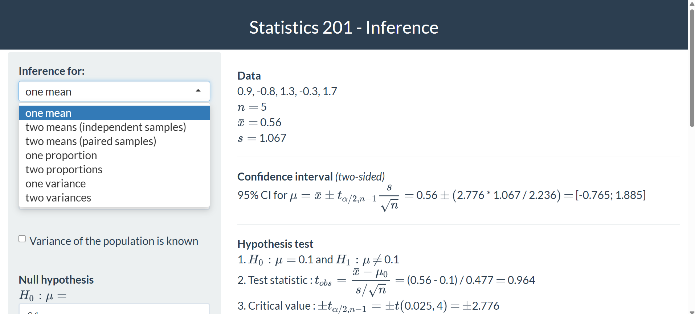
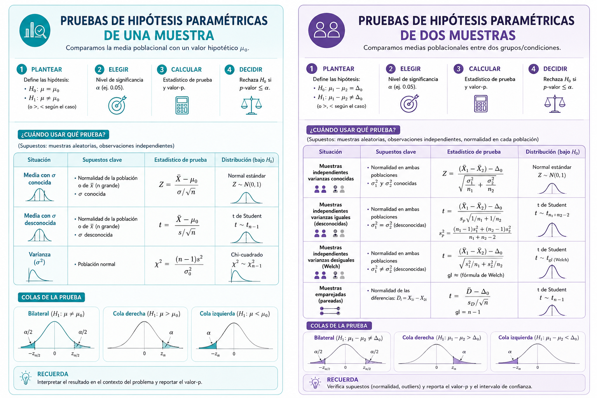
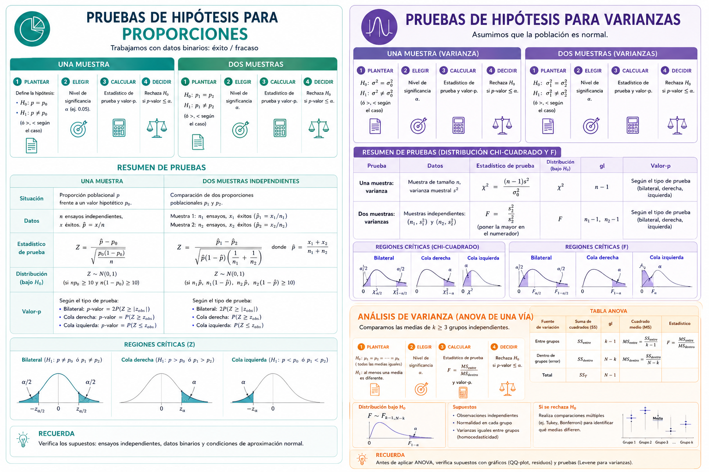

```{r}
library(pacman)
p_load(ggplot2, dplyr, tidyr, patchwork)
```

## Fechas importantes

```{=html}
<style>
/* Logo más pequeño para que no tape la primera línea de texto */
.reveal .slide-logo { max-height: 11% !important; }
/* ---- Infografías ---- */
.info-row { display:flex; gap:0.45em; align-items:stretch; justify-content:center; }
.info-card { flex:1; border-radius:14px; padding:0.35em 0.55em; background:#eef7fb;
             border-top:7px solid #0077b6; box-shadow:0 2px 6px rgba(0,0,0,.12); }
.info-card h4 { margin:0.1em 0 0.25em 0; font-size:1.0em; color:#03045e; text-transform:none; }
.info-card p, .info-card li { font-size:0.95em; margin:0.15em 0; }
.info-arrow { align-self:center; font-size:1.6em; color:#0077b6; font-weight:bold; }
.info-num { display:inline-block; width:1.5em; height:1.5em; line-height:1.5em; border-radius:50%;
            background:#0077b6; color:#fff; text-align:center; font-weight:bold; margin-right:0.25em; }
.info-icon { font-size:1.7em; text-align:center; margin:0.1em 0; }
.c-azul  { border-top-color:#0077b6; background:#eef7fb; }
.c-verde { border-top-color:#2a9d8f; background:#e9f6f4; }
.c-morado{ border-top-color:#6a4c93; background:#f2eef8; }
.c-naranja{border-top-color:#f77f00; background:#fff3e6; }
.c-rojo  { border-top-color:#d62828; background:#fdecec; }
.c-gris  { border-top-color:#6c757d; background:#f4f5f6; }
.mapa table { border-collapse:separate; border-spacing:4px; width:100%; }
.mapa th { background:#03045e; color:#fff; padding:0.25em 0.4em; border-radius:8px; font-size:0.85em; }
.mapa td { padding:0.25em 0.4em; border-radius:8px; vertical-align:middle; text-align:center; font-size:0.78em; }
.mapa td.fila { background:#caf0f8; font-weight:bold; text-align:left; }
.m-media { background:#e7f1fb; } .m-var { background:#f2eef8; } .m-prop { background:#e9f6f4; } .m-na { background:#f4f5f6; color:#888; }
.tag { display:inline-block; padding:0.05em 0.45em; border-radius:10px; background:#0077b6; color:#fff; font-size:0.85em; }
.pregunta { background:#fff8e1; border-left:6px solid #f4a261; padding:0.3em 0.6em; border-radius:6px; }
</style>
```

\newcommand\norm[1]{\left\lVert#1\right\rVert}

<br><br>

1. Examen 4 (Pruebas de hipótesis): **jueves 03 de diciembre**
2. Examen 5 (Intervalos de confianza): jueves 10 de diciembre

<br>

::: {.callout-note}
Los dos temas se trabajan **juntos** en estas diapositivas y en un único taller, porque usan los mismos estimadores, errores estándar y distribuciones. Sin embargo, se **evalúan por separado** en los exámenes 4 y 5.
:::

# INFERENCIA ESTADÍSTICA {background-color="#0077b6"}

## ¿Qué es la inferencia estadística? {style="font-size: 90%;"}

La **inferencia estadística** es el proceso de obtener conclusiones sobre una **población** a partir de una **muestra**.

::: {.fragment}

Dos grandes problemas:

1. **Estimación**: ¿cuánto vale el parámetro?
   - Estimación puntual: $\bar{x}$, $\hat{p}$, $s^2_x$
   - Estimación por intervalo: IC al 90%, 95%, 99% (Examen 5)

2. **Contraste de hipótesis**: ¿es compatible el parámetro con un valor particular?
   - ¿La concentración media de principio activo en los lotes es distinta de la especificación (7%)?
   - ¿El catalizador A produce mayor rendimiento que el catalizador B?
:::

## El ciclo inferencial {style="font-size: 64%;"}

::: {.info-row}

::: {.info-card .c-azul}
<div class="info-icon">🌍</div>
#### Población
Todos los lotes, ríos, individuos...

**Parámetros** (fijos, desconocidos):

$\mu,\; p,\; \sigma^2$
:::

<div class="info-arrow">➜</div>

::: {.info-card .c-verde}
<div class="info-icon">🎲</div>
#### Muestreo aleatorio
Se seleccionan $n$ unidades **al azar**.

Cada muestra posible da un resultado distinto.
:::

<div class="info-arrow">➜</div>

::: {.info-card .c-morado}
<div class="info-icon">🧪</div>
#### Muestra
Datos observados

**Estadísticos** (varían de muestra a muestra):

$\bar{x},\; \hat{p},\; s^2$
:::

<div class="info-arrow">➜</div>

::: {.info-card .c-naranja}
<div class="info-icon">📈</div>
#### Distribución muestral
¿Cómo se comporta el estadístico en **todas** las muestras posibles?

$\bar{X} \sim N\!\left(\mu, \tfrac{\sigma^2}{n}\right)$
:::

<div class="info-arrow">➜</div>

::: {.info-card .c-rojo}
<div class="info-icon">⚖️</div>
#### Inferencia
Estimar el parámetro **o** decidir sobre una afirmación (prueba de hipótesis)

Siempre con un margen de **error** controlado.
:::

:::

<br>

::: {.callout-tip}
La clave de todo el tema: **un estadístico es una variable aleatoria**; su distribución (la distribución muestral) es la que nos permite medir qué tan "raro" es un resultado.
:::

# DISTRIBUCIONES MUESTRALES {background-color="#0077b6"}

## Distribución muestral {style="font-size: 85%;"}

Si tomamos **todas** las muestras posibles de tamaño $n$ y calculamos el estadístico $T$ en cada una, obtenemos la **distribución muestral** de $T$.

::: {.fragment}

**Teorema Central del Límite (TCL):**

Si $X_1, X_2, \ldots, X_n \overset{iid}{\sim} (\mu, \sigma^2)$ y $n$ es suficientemente grande (en la práctica $n \geq 30$):

$$\bar{X} \sim N\!\left(\mu,\; \frac{\sigma^2}{n}\right) \quad \text{aproximadamente}$$

El **error estándar** es $SE = \sigma/\sqrt{n}$: mide cuánto varía $\bar{X}$ de una muestra a otra.

:::

## El TCL en imágenes {style="font-size: 80%;"}

```{r}
#| fig-width: 12
#| fig-height: 4.6
set.seed(123)
# Población asimétrica: tiempo de germinación (días), exponencial con media 4
pob <- data.frame(x = rexp(20000, rate = 1/4))
medias <- function(n) replicate(5000, mean(rexp(n, rate = 1/4)))
d5  <- data.frame(x = medias(5))
d30 <- data.frame(x = medias(30))

g0 <- ggplot(pob, aes(x)) +
  geom_histogram(aes(y = after_stat(density)), bins = 50, fill = "#adb5bd", color = "white") +
  coord_cartesian(xlim = c(0, 20)) +
  labs(title = "1. Población (asimétrica)", subtitle = "media = 4, desv. = 4",
       x = "Tiempo de germinación (días)", y = "Densidad") +
  theme_minimal(base_size = 13)

hist_med <- function(d, n, col) {
  ggplot(d, aes(x)) +
    geom_histogram(aes(y = after_stat(density)), bins = 40, fill = col, color = "white", alpha = .85) +
    stat_function(fun = dnorm, args = list(mean = 4, sd = 4/sqrt(n)),
                  color = "#d62828", linewidth = 1.2) +
    coord_cartesian(xlim = c(0, 10)) +
    labs(title = paste0(ifelse(n == 5, "2", "3"), ". Medias de 5000 muestras, n = ", n),
         subtitle = paste0("SE = 4/raiz(", n, ") = ", round(4/sqrt(n), 2)),
         x = "Media muestral (días)", y = NULL) +
    theme_minimal(base_size = 13)
}
g0 + hist_med(d5, 5, "#4895ef") + hist_med(d30, 30, "#3a0ca3")
```

::: {.callout-note}
Aunque la población es muy asimétrica, la distribución de $\bar{X}$ se vuelve **normal** (curva roja) y **más angosta** a medida que crece $n$.
:::

## Suma y promedio de variables normales {style="font-size: 85%;"}

::: columns

::: {.column width="50%"}

Si $X_1, \ldots, X_n \overset{iid}{\sim} N(\mu, \sigma^2)$:

$$\sum_{i=1}^n X_i \sim N(n\mu,\; n\sigma^2)$$

$$\bar{X} = \frac{1}{n}\sum_{i=1}^n X_i \sim N\!\left(\mu,\; \frac{\sigma^2}{n}\right)$$

::: {.fragment}

La variable **estandarizada**:

$$Z = \frac{\bar{X} - \mu}{\sigma/\sqrt{n}} \sim N(0,1)$$

:::

:::

::: {.column width="50%"}

```{r}
#| fig-width: 5
#| fig-height: 4.5
x_seq <- seq(-4, 4, length.out = 500)
df_tcl <- data.frame(
  x = rep(x_seq, 4),
  y = c(dnorm(x_seq, 0, 1), dnorm(x_seq, 0, 1/sqrt(5)),
        dnorm(x_seq, 0, 1/sqrt(20)), dnorm(x_seq, 0, 1/sqrt(50))),
  n = rep(c("n = 1", "n = 5", "n = 20", "n = 50"), each = 500)
)
df_tcl$n <- factor(df_tcl$n, levels = c("n = 1", "n = 5", "n = 20", "n = 50"))
ggplot(df_tcl, aes(x, y, color = n)) +
  geom_line(linewidth = 1.2) +
  scale_color_manual(values = c("#adb5bd", "#4895ef", "#4361ee", "#3a0ca3")) +
  labs(x = "Desviaciones respecto a la media", y = "Densidad", color = "Tamaño\nde muestra",
       title = "La variabilidad de la media\ndisminuye con n") +
  theme_minimal(base_size = 13) +
  theme(legend.position = "right")
```

:::

:::

## Distribución muestral de una proporción {style="font-size: 85%;"}

Si $X$ = número de éxitos en $n$ ensayos independientes con probabilidad $p$, la proporción muestral es $\hat{p} = X/n$.

Por el TCL, si $np \geq 5$ y $n(1-p) \geq 5$:

$$\hat{p} \sim N\!\left(p,\; \frac{p(1-p)}{n}\right) \qquad \Longrightarrow \qquad Z = \frac{\hat{p} - p}{\sqrt{p(1-p)/n}} \sim N(0,1)$$

::: {.callout-tip}
**Resumen:** tanto $\bar{X}$ como $\hat{p}$ se comportan como una **normal** centrada en el parámetro, con error estándar que disminuye con $\sqrt{n}$. Esta es la base de las pruebas $Z$.
:::

## Ejemplo: probabilidades con la media muestral {style="font-size: 85%;"}

La concentración de nitratos en los pozos de una región tiene media $\mu = 12$ mg/L y desviación $\sigma = 4$ mg/L. Se toma una muestra aleatoria de $n = 25$ pozos. ¿Cuál es la probabilidad de que la concentración **media** de la muestra supere 13.5 mg/L?

::: {.fragment}

**Solución:**

$$\bar{X} \sim N\!\left(12,\; \frac{4^2}{25}\right), \qquad SE = \frac{4}{\sqrt{25}} = 0.8$$

$$P(\bar{X} > 13.5) = P\!\left(Z > \frac{13.5 - 12}{0.8}\right) = P(Z > 1.875) = 0.0304$$

Solo un 3% de las muestras de 25 pozos tendrían un promedio mayor a 13.5 mg/L.

:::

## Tu turno {style="font-size: 85%;"}

**Ejercicio 1.** Un proveedor afirma que el 80% de sus semillas germinan ($p = 0.80$). Usted siembra una muestra aleatoria de $n = 100$ semillas.

a) ¿Cuál es la distribución aproximada de $\hat{p}$? ¿Se cumplen las condiciones?

b) Si la afirmación del proveedor es cierta, ¿cuál es la probabilidad de que germine **menos del 72%** de su muestra?

c) Si en su muestra germinaron 72 semillas, ¿qué pensaría de la afirmación del proveedor?

## Solución {style="font-size: 85%;"}

a) $np = 80 \geq 5$ y $n(1-p) = 20 \geq 5$, entonces

$$\hat{p} \sim N\!\left(0.80,\; \frac{0.80 \times 0.20}{100}\right), \qquad SE = \sqrt{0.0016} = 0.04$$

b) $$P(\hat{p} < 0.72) = P\!\left(Z < \frac{0.72 - 0.80}{0.04}\right) = P(Z < -2) = 0.0228$$

c) Si el proveedor dijera la verdad, observar 72% o menos solo ocurriría en el 2.3% de las muestras. Es un resultado **poco probable** bajo su afirmación, lo que hace dudar de ella.

::: {.callout-important}
¡Este razonamiento **es** una prueba de hipótesis! Lo formalizaremos más adelante.
:::

## El estimador: propiedades deseables {style="font-size: 76%;"}

Un **estimador** $\hat{\theta}$ de un parámetro $\theta$ es una función de los datos muestrales que busca aproximarse al valor verdadero.

| Propiedad | Significado |
|-----------|-------------|
| **Insesgado** | $E[\hat\theta] = \theta$ |
| **Consistente** | $\hat\theta \xrightarrow{p} \theta$ cuando $n \to \infty$ |
| **Eficiente** | Varianza mínima |

::: {.callout-tip}
**En ciencias experimentales:**

- $\bar{X}$ es estimador insesgado de $\mu$ (concentración media de un analito)
- $\hat{p} = X/n$ es estimador insesgado de $p$ (proporción de lotes conformes)
- $S^2$ con divisor $n-1$ es insesgado para $\sigma^2$
:::

::: {.fragment}
La calidad de un estimador mejora al **aumentar el tamaño de muestra**. El error estándar $SE = s/\sqrt{n}$ cuantifica la precisión.
:::

## Las distribuciones que vamos a usar {style="font-size: 70%;"}

::: {.info-row}

::: {.info-card .c-azul}
<div class="info-icon">🔔</div>
#### Normal estándar $Z$
Simétrica, centrada en 0.

**Se usa para:** medias con $\sigma$ conocida y proporciones.

$Z = \dfrac{\bar{X} - \mu}{\sigma/\sqrt{n}}$
:::

::: {.info-card .c-verde}
<div class="info-icon">🔔</div>
#### $t$ de Student
Simétrica, colas más pesadas que $Z$; depende de los **gl**.

**Se usa para:** medias con $\sigma$ **desconocida**.

$T = \dfrac{\bar{X} - \mu}{S/\sqrt{n}}$
:::

::: {.info-card .c-morado}
<div class="info-icon">📐</div>
#### Chi-cuadrado $\chi^2$
Solo valores positivos, asimétrica.

**Se usa para:** una varianza y tablas de contingencia.

$\chi^2 = \dfrac{(n-1)S^2}{\sigma^2}$
:::

::: {.info-card .c-naranja}
<div class="info-icon">📐</div>
#### $F$ de Fisher
Solo valores positivos, asimétrica; dos **gl**.

**Se usa para:** comparar dos varianzas.

$F = \dfrac{S_1^2}{S_2^2}$
:::

:::

## Distribución Chi-cuadrado ($\chi^2$)

```{r}
#| fig-width: 9.5
#| fig-height: 6
x_ch <- seq(0.01, 30, length.out = 500)
df_ch <- data.frame(
  x = rep(x_ch, 4),
  y = c(dchisq(x_ch, 1), dchisq(x_ch, 3), dchisq(x_ch, 8), dchisq(x_ch, 15)),
  gl = rep(c("k = 1", "k = 3", "k = 8", "k = 15"), each = 500)
)
df_ch$gl <- factor(df_ch$gl, levels = c("k = 1", "k = 3", "k = 8", "k = 15"))
ggplot(df_ch, aes(x, y, color = gl)) +
  geom_line(linewidth = 1.3) +
  scale_color_manual(values = c("#e63946", "#f77f00", "#2dc653", "#0077b6")) +
  coord_cartesian(ylim = c(0, 0.5)) +
  labs(x = expression(chi^2), y = "Densidad", color = "gl",
       title = expression("Distribución " * chi^2)) +
  theme_bw(base_size = 13) +
  theme(legend.position = "bottom")
```

## Distribución Chi-cuadrado ($\chi^2$) {style="font-size: 90%;"}

Si $Z_1, \ldots, Z_k \overset{iid}{\sim} N(0,1)$:

$$X^2_k = Z_1^2 + Z_2^2 + \cdots + Z_k^2 \sim \chi^2_{(k)}$$

**Usos:**

> Prueba de independencia (tablas de contingencia)
>
> Inferencia sobre **varianzas**
>
> Prueba de bondad de ajuste

Solo toma valores mayores que cero; se vuelve más simétrica cuando crece $k$.

## Distribución t de Student

```{r}
#| fig-width: 8.5
#| fig-height: 6
x_t <- seq(-5, 5, length.out = 500)
df_t <- data.frame(
  x = rep(x_t, 5),
  y = c(dt(x_t, 1), dt(x_t, 5), dt(x_t, 10), dt(x_t, 30), dnorm(x_t)),
  dist = rep(c("t(1)", "t(5)", "t(10)", "t(30)", "Normal"), each = 500)
)
df_t$dist <- factor(df_t$dist, levels = c("t(1)", "t(5)", "t(10)", "t(30)", "Normal"))
ggplot(df_t, aes(x, y, color = dist, linetype = dist)) +
  geom_line(linewidth = 1.2) +
  scale_color_manual(values = c("#e63946", "#f77f00", "#2dc653", "#0077b6", "#212121")) +
  scale_linetype_manual(values = c("solid", "solid", "solid", "solid", "dashed")) +
  labs(x = "t", y = "Densidad", color = "Distribución", linetype = "Distribución",
       title = "Distribución t de Student vs Normal") +
  theme_bw(base_size = 13) +
  theme(legend.position = "bottom")
```

## Distribución t de Student {style="font-size: 90%;"}

Si $Z \sim N(0,1)$ y $V \sim \chi^2(k)$ independientes:

$$T = \frac{Z}{\sqrt{V/k}} \sim t_{(k)}$$

En la práctica:

$$T = \frac{\bar{X} - \mu}{S/\sqrt{n}} \sim t_{(n-1)}$$

**Usos:** Inferencia sobre medias cuando $\sigma$ es **desconocida**.

- Más dispersa que $N(0,1)$
- Con $k \to \infty$ converge a $N(0,1)$

## Distribución F de Fisher-Snedecor

```{r}
#| fig-width: 8.5
#| fig-height: 6
x_f <- seq(0.01, 8, length.out = 500)
df_f <- data.frame(
  x = rep(x_f, 4),
  y = c(df(x_f, 2, 5), df(x_f, 5, 10), df(x_f, 10, 20), df(x_f, 20, 50)),
  param = rep(c("F(2,5)", "F(5,10)", "F(10,20)", "F(20,50)"), each = 500)
)
df_f$param <- factor(df_f$param, levels = c("F(2,5)", "F(5,10)", "F(10,20)", "F(20,50)"))
ggplot(df_f, aes(x, y, color = param)) +
  geom_line(linewidth = 1.3) +
  coord_cartesian(ylim = c(0, 1.5)) +
  scale_color_manual(values = c("#e63946", "#f77f00", "#2dc653", "#0077b6")) +
  labs(x = "F", y = "Densidad", color = "Parámetros",
       title = "Distribución F de Fisher-Snedecor") +
  theme_bw(base_size = 13) +
  theme(legend.position = "bottom")
```

## Distribución F de Fisher-Snedecor {style="font-size: 90%;"}

Si $U \sim \chi^2(k_1)$ y $V \sim \chi^2(k_2)$ independientes:

$$F = \frac{U/k_1}{V/k_2} \sim F^{k_1}_{k_2}$$

En la práctica:

$$F = \frac{S_1^2}{S_2^2}\sim F^{n_1-1}_{n_2-1} \quad \text{(bajo } H_0: \sigma_1^2=\sigma_2^2\text{)}$$

**Usos:**

- Comparar **varianzas** (dos muestras)

Solo toma valores mayores que cero; asimétrica positiva.

# INTERVALOS DE CONFIANZA {background-color="#0077b6"}

## De la estimación puntual a la estimación por intervalo {style="font-size: 88%;"}

La inferencia estadística tiene dos grandes problemas: **estimación** y **contraste de hipótesis**. Empezamos por la estimación por intervalo.

::: {.fragment}
- **Estimación puntual:** un solo valor ($\bar{x}$, $\hat{p}$, $s^2$) que aproxima al parámetro
- **Estimación por intervalo:** un rango de valores plausibles para el parámetro, con un **nivel de confianza** asociado
:::

::: {.fragment}
::: {.callout-tip}
**En ciencias experimentales:** un IC comunica no solo el efecto estimado, sino también la **incertidumbre** de la estimación, algo esencial para la toma de decisiones en el laboratorio y la producción.
:::
:::

## ¿Qué es un intervalo de confianza? {style="font-size: 85%;"}

Un IC del $(1-\alpha)$% es un rango $(L, U)$ construido a partir de los datos, tal que si repitiéramos el muestreo muchas veces, el $(1-\alpha)$% de esos intervalos contendría al verdadero parámetro.

Estructura general:

$$\boxed{\text{Estimador} \;\pm\; (\text{valor crítico}) \times (\text{Error estándar})}$$

::: {.fragment}
- **Estimador:** $\hat{p}$, $\bar{x}$, $\bar{x}_1-\bar{x}_2$, $\bar{d}$, $s^2$, $s_1^2/s_2^2$
- **Valor crítico:** depende de la distribución del estadístico ($Z$, $t$, $\chi^2$, $F$) y del nivel de confianza
- **Error estándar:** mide la variabilidad del estimador
- El producto (valor crítico) $\times$ (error estándar) se llama **margen de error**
:::

## ¿Qué significa "95% de confianza"? {style="font-size: 80%;"}

```{r}
#| fig-width: 12
#| fig-height: 4.7
set.seed(2026)
k <- 50; n <- 25; mu <- 12; sigma <- 4
xb <- replicate(k, mean(rnorm(n, mu, sigma)))
me <- qnorm(.975) * sigma / sqrt(n)
ics <- data.frame(muestra = 1:k, xb = xb, L = xb - me, U = xb + me)
ics$cubre <- ifelse(ics$L <= mu & ics$U >= mu, "Contiene a la media", "No la contiene")
ggplot(ics, aes(x = muestra, y = xb, ymin = L, ymax = U, color = cubre)) +
  geom_hline(yintercept = mu, linetype = "dashed", linewidth = 1) +
  geom_errorbar(width = .4, linewidth = .9) + geom_point(size = 1.8) +
  scale_color_manual(values = c("#0077b6", "#d62828")) +
  annotate("text", x = k + 1.5, y = mu, label = "mu == 12", parse = TRUE, hjust = 0, size = 5) +
  coord_cartesian(xlim = c(1, k + 4)) +
  labs(x = "Muestra (n = 25 pozos cada una)", y = "Nitratos (mg/L)", color = NULL,
       title = paste0("50 intervalos del 95%: ", sum(ics$cubre == "Contiene a la media"),
                      " contienen la media verdadera")) +
  theme_minimal(base_size = 14) + theme(legend.position = "top")
```

Cada muestra da un intervalo distinto. El **método** acierta el 95% de las veces; para **un** intervalo ya calculado, el parámetro está o no está dentro (no es una probabilidad).

## Nivel de confianza y valor crítico {style="font-size: 85%;"}

| Confianza | $\alpha$ | $z_{\alpha/2}$ |
|:---:|:---:|:---:|
| 90% | 0.10 | 1.645 |
| 95% | 0.05 | 1.960 |
| 99% | 0.01 | 2.576 |

::: {.fragment}
Cuando el estadístico pivote es $t$, $\chi^2$ o $F$, el valor crítico depende además de los **grados de libertad**.
:::

::: {.fragment}
::: {.callout-note}
A **mayor confianza**, mayor amplitud del intervalo (menos precisión); a **mayor tamaño de muestra**, menor amplitud (mayor precisión).
:::
:::

## ¿Cómo se interpreta un IC? {style="font-size: 70%;"}

::: {.info-row}

::: {.info-card .c-verde}
<div class="info-icon">✅</div>
#### Interpretaciones correctas
- "Con 95% de confianza, la concentración media de nitratos de **la población** de pozos está entre 11.3 y 14.5 mg/L."
- "Si repitiéramos el muestreo muchas veces, el 95% de los intervalos construidos así contendrían a $\mu$."
- "Los valores dentro del intervalo son valores **plausibles** para el parámetro."
:::

::: {.info-card .c-rojo}
<div class="info-icon">❌</div>
#### Interpretaciones incorrectas
- "El 95% de los pozos tiene nitratos entre 11.3 y 14.5 mg/L." (el IC es para la **media**, no para los datos individuales)
- "Hay 95% de probabilidad de que $\bar{x}$ esté en el intervalo." ($\bar{x}$ siempre está: es el centro)
- "El intervalo cambia, pero $\mu$ tiene 95% de probabilidad de..." ($\mu$ es fija; lo aleatorio es el intervalo)
:::

:::

## Ejemplo: IC para una media ($\sigma$ conocida) {style="font-size: 85%;"}

En una muestra de $n = 25$ pozos se obtuvo una concentración media de nitratos de $\bar{x} = 12.9$ mg/L. Por estudios previos, $\sigma = 4$ mg/L. Construya un IC del 95% para la concentración media de la región.

$$\boxed{\bar{x} \;\pm\; z_{\alpha/2}\frac{\sigma}{\sqrt{n}}}$$

::: {.fragment}

$$SE = \frac{4}{\sqrt{25}} = 0.8 \qquad \text{Margen de error} = 1.96 \times 0.8 = 1.568$$

$$IC_{95\%}(\mu) = 12.9 \pm 1.568 = \mathbf{[11.33,\; 14.47]} \text{ mg/L}$$

**Interpretación:** con 95% de confianza, la concentración media de nitratos en los pozos de la región está entre 11.33 y 14.47 mg/L.

:::

## Tu turno {style="font-size: 85%;"}

**Ejercicio 2.** Un sensor de temperatura de laboratorio tiene $\sigma = 0.2$ °C (conocida de fábrica). En 10 mediciones de un baño termostatado se obtuvo $\bar{x} = 37.1$ °C.

a) Construya un IC del 95% para la temperatura media del baño.

b) Repita con 99% de confianza. ¿Qué le pasa al ancho del intervalo?

c) ¿Es plausible que el baño esté a 37.0 °C?

::: {.fragment}

**Solución:** $SE = 0.2/\sqrt{10} = 0.0632$

a) $37.1 \pm 1.96(0.0632) = 37.1 \pm 0.124 = [36.98,\; 37.22]$ °C

b) $37.1 \pm 2.576(0.0632) = 37.1 \pm 0.163 = [36.94,\; 37.26]$ °C: más confianza → intervalo **más ancho**.

c) Sí: 37.0 está dentro de ambos intervalos, es un valor plausible para la media.

:::

# CONTRASTE DE HIPÓTESIS {background-color="#0077b6"}

## Pruebas de hipótesis

{fig-align="center" height="560"}

## Una prueba de hipótesis es como un juicio {style="font-size: 68%;"}

::: {.info-row}

::: {.info-card .c-gris}
<div class="info-icon">👨‍⚖️</div>
#### En un juicio
- Se **presume la inocencia** del acusado.
- La fiscalía presenta **pruebas**.
- Se condena solo si las pruebas son contundentes, **más allá de toda duda razonable**.
- Si no hay pruebas suficientes, el veredicto es **"no culpable"** (que no es lo mismo que "inocente").
- Se puede **condenar a un inocente** o **absolver a un culpable**.
:::

<div class="info-arrow">⇄</div>

::: {.info-card .c-azul}
<div class="info-icon">🔬</div>
#### En una prueba de hipótesis
- Se supone cierta la **hipótesis nula $H_0$** (no hay efecto, no hay diferencia).
- Los **datos de la muestra** son la evidencia.
- Se rechaza $H_0$ solo si los datos serían **muy raros** bajo $H_0$: valor-p $\leq \alpha$.
- Si no hay evidencia suficiente, **"no se rechaza $H_0$"** (no decimos "se acepta").
- Se puede cometer **error tipo I** (rechazar $H_0$ verdadera) o **error tipo II** (no rechazar $H_0$ falsa).
:::

:::

<br>

::: {.callout-tip}
La **carga de la prueba** está en la hipótesis alterna: los datos deben demostrar $H_a$.
:::

## Estructura general del contraste {style="font-size: 68%;"}

Un **contraste de hipótesis** es una regla de decisión que permite, a partir de los datos muestrales, decidir sobre una afirmación acerca de un parámetro poblacional.

::: {.info-row}

::: {.info-card .c-azul}
<span class="info-num">1</span>**PLANTEAR**
<div class="info-icon">📝</div>
Escribir $H_0$ y $H_a$ en términos del **parámetro** ($\mu$, $p$, $\sigma^2$...).
:::

::: {.info-card .c-verde}
<span class="info-num">2</span>**ELEGIR**
<div class="info-icon">🎯</div>
Nivel de significancia $\alpha$ (usualmente 0.05) y el **estadístico de prueba** adecuado.
:::

::: {.info-card .c-morado}
<span class="info-num">3</span>**CALCULAR**
<div class="info-icon">🧮</div>
Valor del estadístico con los datos y su **valor-p** (o el valor crítico).
:::

::: {.info-card .c-naranja}
<span class="info-num">4</span>**DECIDIR**
<div class="info-icon">⚖️</div>
Rechazar $H_0$ si valor-p $\leq \alpha$ (o si el estadístico cae en la región de rechazo).
:::

::: {.info-card .c-rojo}
<span class="info-num">5</span>**CONCLUIR**
<div class="info-icon">💬</div>
Interpretar la decisión **en el contexto** del problema, en palabras.
:::

:::

## Hipótesis nula y alterna {style="font-size: 85%;"}

::: {.callout-note}
**Hipótesis nula** $H_0$: afirmación de partida que supone igualdad, ausencia de efecto o valor de referencia. **Siempre lleva el signo igual.**

**Hipótesis alterna** $H_a$: lo que quiere demostrarse; contiene $\neq$, $>$ o $<$.
:::

::: {.fragment}

| Prueba | $H_a$ | Región de rechazo |
|--------|-------|-------------------|
| Bilateral | $\theta \neq \theta_0$ | Dos colas |
| Unilateral derecha | $\theta > \theta_0$ | Cola derecha |
| Unilateral izquierda | $\theta < \theta_0$ | Cola izquierda |

:::

## Las colas de la prueba {style="font-size: 85%;"}

```{r}
#| fig-width: 12
#| fig-height: 3.8
x <- seq(-4, 4, length.out = 600)
base <- data.frame(x = x, y = dnorm(x))
cola <- function(a, b) { xx <- seq(a, b, length.out = 200); data.frame(x = xx, y = dnorm(xx)) }
pl <- function(areas, titulo, etiquetas) {
  g <- ggplot(base, aes(x, y)) + geom_line(linewidth = 1.1, color = "#03045e")
  for (a in areas) g <- g + geom_area(data = a, aes(x, y), fill = "#2a9d8f", alpha = .6)
  g + etiquetas + labs(title = titulo, x = NULL, y = NULL) +
    theme_minimal(base_size = 14) + theme(axis.text.y = element_blank())
}
z2 <- qnorm(.975); z1 <- qnorm(.95)
p1 <- pl(list(cola(-4, -z2), cola(z2, 4)), "Bilateral: Ha con diferente",
         annotate("text", x = c(-2.9, 2.9), y = .1, label = "alpha/2", parse = TRUE, size = 5))
p2 <- pl(list(cola(z1, 4)), "Cola derecha: Ha con >",
         annotate("text", x = 2.7, y = .1, label = "alpha", parse = TRUE, size = 5))
p3 <- pl(list(cola(-4, -z1)), "Cola izquierda: Ha con <",
         annotate("text", x = -2.7, y = .1, label = "alpha", parse = TRUE, size = 5))
p1 + p2 + p3
```

La **región de rechazo** (verde) está en la dirección que indica $H_a$. Su área total es $\alpha$.

## ¿Cómo leer el enunciado? Palabras clave {style="font-size: 78%;"}

| Si la pregunta del estudio dice... | Hipótesis alterna |
|------------------------------------|:-----------------:|
| "es diferente", "difiere", "cambió", "es distinta de la especificación" | $H_a: \theta \neq \theta_0$ |
| "es mayor", "supera", "aumentó", "excede", "más de", "mejoró" (si mejorar es subir) | $H_a: \theta > \theta_0$ |
| "es menor", "es inferior", "disminuyó", "reduce", "menos de" | $H_a: \theta < \theta_0$ |
| "al menos", "como mínimo", "no menos de" (afirmación que se pone en duda) | La afirmación va a $H_0$; $H_a: \theta < \theta_0$ |
| "a lo sumo", "como máximo", "no más de" (afirmación que se pone en duda) | La afirmación va a $H_0$; $H_a: \theta > \theta_0$ |

::: {.callout-important}
**Regla de oro:** $H_a$ es lo que el investigador **quiere demostrar** o **sospecha**. El signo "=" siempre queda en $H_0$.
:::

## Ejemplo: plantear hipótesis {style="font-size: 85%;"}

Escriba $H_0$ y $H_a$ en cada caso:

a) Un fabricante afirma que sus cápsulas contienen **en promedio 250 mg** de principio activo. Un ente regulador sospecha que contienen **menos**.

b) Un ecólogo quiere saber si la **proporción** de anfibios infectados con quitridio en un páramo es **diferente** del 30% reportado hace 10 años.

c) Se quiere demostrar que un nuevo método de titulación tiene **menor variabilidad** que el método estándar ($\sigma_0 = 0.5$ mL).

::: {.fragment}

**Solución:**

a) $H_0: \mu = 250$ mg vs $H_a: \mu < 250$ mg (cola izquierda)

b) $H_0: p = 0.30$ vs $H_a: p \neq 0.30$ (bilateral)

c) $H_0: \sigma = 0.5$ vs $H_a: \sigma < 0.5$ (cola izquierda; equivalente con $\sigma^2$)

:::

## Tu turno {style="font-size: 85%;"}

**Ejercicio 3.** Escriba $H_0$ y $H_a$ e indique el tipo de cola:

a) Se sospecha que la concentración media de mercurio en peces de un embalse **supera** el límite de 0.5 µg/g.

b) Un laboratorio afirma que **al menos el 95%** de sus kits detectan correctamente una bacteria. Un cliente cree que el porcentaje es menor.

c) Se quiere comprobar si el tiempo medio de disolución de las tabletas **es diferente** en dos formulaciones.

d) Se quiere demostrar que un tratamiento **reduce** la presión arterial (misma rata medida antes y después).

## Solución {style="font-size: 85%;"}

a) $H_0: \mu = 0.5$ vs $H_a: \mu > 0.5$ µg/g (cola derecha)

b) $H_0: p = 0.95$ vs $H_a: p < 0.95$ (cola izquierda). La afirmación "al menos" queda en $H_0$.

c) $H_0: \mu_1 = \mu_2$ vs $H_a: \mu_1 \neq \mu_2$ (bilateral)

d) Con $D = \text{antes} - \text{después}$: $H_0: \mu_D = 0$ vs $H_a: \mu_D > 0$ (cola derecha)

::: {.callout-tip}
En (d) el signo de $H_a$ depende de cómo se defina la diferencia. Si $D = \text{después} - \text{antes}$, entonces $H_a: \mu_D < 0$. Lo importante es ser **coherente**.
:::

# TIPOS DE ERROR {background-color="#0077b6"}

## Tipos de error {style="font-size: 85%;"}

<div class="mapa">
<table>
<tr><th></th><th>$H_0$ es verdadera</th><th>$H_0$ es falsa</th></tr>
<tr><td class="fila">Rechazar $H_0$</td><td style="background:#fdecec; font-size:0.9em;">❌ <b>Error tipo I</b><br>probabilidad $\alpha$</td><td style="background:#e9f6f4; font-size:0.9em;">✅ Decisión correcta<br>Potencia $1-\beta$</td></tr>
<tr><td class="fila">No rechazar $H_0$</td><td style="background:#e9f6f4; font-size:0.9em;">✅ Decisión correcta<br>$1-\alpha$</td><td style="background:#fff3e6; font-size:0.9em;">❌ <b>Error tipo II</b><br>probabilidad $\beta$</td></tr>
</table>
</div>

- **$\alpha$** = P(rechazar $H_0$ | $H_0$ verdadera) = **nivel de significancia**
- **$\beta$** = P(no rechazar $H_0$ | $H_0$ falsa)
- **Potencia** = $1 - \beta$ = P(detectar el efecto cuando existe)

::: {.callout-warning}
**En control de calidad** ($H_0$: el lote cumple):

- Error tipo I: rechazar un lote que **sí** cumple → pérdida económica innecesaria
- Error tipo II: aprobar un lote que **no** cumple → riesgo para el consumidor
:::

## Relación entre $\alpha$, $\beta$ y potencia

```{r}
#| fig-width: 11
#| fig-height: 6
mu0 <- 0; mu1 <- 1; sigma <- 1.8; n <- 25
se <- sigma / sqrt(n)
alpha <- 0.05
z_alpha <- qnorm(1 - alpha/2)
critico_izq <- mu0 - z_alpha * se
critico_der <- mu0 + z_alpha * se
x_seq <- seq(mu0 - 4*se, mu1 + 4*se, length.out = 1200)
df <- data.frame(x = rep(x_seq, 2),
                 y = c(dnorm(x_seq, mu0, se), dnorm(x_seq, mu1, se)),
                 hipotesis = rep(c("H0", "Ha"), each = length(x_seq)))
area <- function(a, b, m) { xx <- seq(a, b, length.out = 300); data.frame(x = xx, y = dnorm(xx, m, se)) }
df_alpha_der <- area(critico_der, max(x_seq), mu0)
df_alpha_izq <- area(min(x_seq), critico_izq, mu0)
df_beta      <- area(critico_izq, critico_der, mu1)
df_power_1   <- area(min(x_seq), critico_izq, mu1)
df_power_2   <- area(critico_der, max(x_seq), mu1)

ggplot(df, aes(x, y, color = hipotesis)) +
  geom_line(linewidth = 1.5) +
  geom_area(data = df_alpha_der, aes(x, y), fill = "#d62828", alpha = 0.45, inherit.aes = FALSE) +
  geom_area(data = df_alpha_izq, aes(x, y), fill = "#d62828", alpha = 0.45, inherit.aes = FALSE) +
  geom_area(data = df_beta, aes(x, y), fill = "#f4a261", alpha = 0.5, inherit.aes = FALSE) +
  geom_area(data = df_power_1, aes(x, y), fill = "#2a9d8f", alpha = 0.5, inherit.aes = FALSE) +
  geom_area(data = df_power_2, aes(x, y), fill = "#2a9d8f", alpha = 0.5, inherit.aes = FALSE) +
  geom_vline(xintercept = c(critico_izq, critico_der), linetype = "dashed",
             color = "gray20", linewidth = 0.8) +
  annotate("text", x = critico_der + 0.15, y = 1.30, label = "Valor crítico", size = 4) +
  annotate("text", x = critico_izq - 0.15, y = 1.30, label = "Valor crítico", size = 4) +
  annotate("text", x = critico_der + 0.25, y = dnorm(critico_der, mu0, se)/2 + 0.1,
           label = "alpha/2", parse = TRUE, color = "#d62828", size = 7) +
  annotate("text", x = critico_izq - 0.25, y = dnorm(critico_izq, mu0, se)/2 + 0.1,
           label = "alpha/2", parse = TRUE, color = "#d62828", size = 7) +
  annotate("text", x = mu0 + 0.2, y = dnorm(mu0 + 0.2, mu1, se)*0.8 + 0.2,
           label = "beta", parse = TRUE, color = "#e76f51", size = 8) +
  annotate("text", x = mu1 + 0.9, y = dnorm(mu1 + 0.9, mu1, se)*0.65 + 0.3,
           label = "Potencia\n(1 - beta)", color = "#2a9d8f", size = 5, fontface = "bold") +
  annotate("text", x = 0, y = 1.55, label = "Nivel de confianza (1 - alfa)", size = 5, fontface = "bold") +
  scale_color_manual(values = c("H0" = "#1d3557", "Ha" = "#6a4c93"),
                     labels = c(expression(H[0]:mu == mu[0]), expression(H[a]:mu == mu[1]))) +
  labs(title = "Errores Tipo I y II, Potencia y Nivel de Confianza",
       subtitle = "Prueba bilateral para la media",
       x = "Media muestral", y = "Densidad", color = NULL) +
  theme_minimal(base_size = 14) +
  theme(legend.position = "top",
        plot.title = element_text(face = "bold", size = 18),
        plot.subtitle = element_text(size = 12, color = "gray35"),
        panel.grid.minor = element_blank())
```

## ¿Qué pasa si aumentamos $n$? {style="font-size: 80%;"}

```{r}
#| fig-width: 12
#| fig-height: 4.6
graf_n <- function(n) {
  se <- 6/sqrt(n); c0 <- 50 + qnorm(.95)*se
  xs <- seq(40, 64, length.out = 800)
  d <- data.frame(x = rep(xs, 2), y = c(dnorm(xs, 50, se), dnorm(xs, 54, se)),
                  h = rep(c("H0: mu = 50", "Ha: mu = 54"), each = 800))
  a <- data.frame(x = seq(c0, 64, length.out = 200)); a$y <- dnorm(a$x, 50, se)
  b <- data.frame(x = seq(40, c0, length.out = 200)); b$y <- dnorm(b$x, 54, se)
  ggplot(d, aes(x, y, color = h)) + geom_line(linewidth = 1.2) +
    geom_area(data = b, aes(x, y), fill = "#f4a261", alpha = .6, inherit.aes = FALSE) +
    geom_area(data = a, aes(x, y), fill = "#d62828", alpha = .5, inherit.aes = FALSE) +
    geom_vline(xintercept = c0, linetype = "dashed") +
    scale_color_manual(values = c("#1d3557", "#6a4c93")) +
    labs(title = paste0("n = ", n, ":  alfa = 0.05,  beta = ", round(pnorm(c0, 54, se), 3)),
         x = "Media muestral", y = NULL, color = NULL) +
    theme_minimal(base_size = 14) + theme(legend.position = "top")
}
graf_n(9) + graf_n(36)
```

::: {.callout-tip}
Con el **mismo $\alpha$**, al aumentar $n$ las curvas se hacen más angostas, se traslapan menos y $\beta$ **disminuye** (la potencia aumenta). Con $n$ fijo, reducir $\alpha$ hace que $\beta$ **aumente**.
:::

## Ejemplo: calcular $\alpha$ y $\beta$ {style="font-size: 82%;"}

El contenido medio de proteína declarado en un suplemento es 100 g/kg, con $\sigma = 10$ g/kg. Para verificar si el contenido **es mayor**, se analizan $n = 25$ muestras y se usa la regla: **rechazar $H_0: \mu = 100$ si $\bar{x} > 103.5$**.

a) ¿Cuál es la probabilidad de cometer error tipo I?

b) Si en realidad $\mu = 105$, ¿cuál es $\beta$? ¿Y la potencia?

::: {.fragment}

**Solución:** $SE = 10/\sqrt{25} = 2$

a) $\alpha = P(\bar{X} > 103.5 \mid \mu = 100) = P\!\left(Z > \frac{103.5 - 100}{2}\right) = P(Z > 1.75) = 0.0401$

b) $\beta = P(\bar{X} \leq 103.5 \mid \mu = 105) = P\!\left(Z \leq \frac{103.5 - 105}{2}\right) = P(Z \leq -0.75) = 0.2266$

Potencia $= 1 - 0.2266 = 0.7734$: si $\mu = 105$, la prueba lo detecta el 77% de las veces.

:::

## Tu turno {style="font-size: 85%;"}

**Ejercicio 4.** El tiempo medio de coagulación de un plasma de referencia es 20 s, con $\sigma = 4$ s. Un anticoagulante, se sospecha, **reduce** este tiempo. Con $n = 16$ muestras se usa la regla: **rechazar $H_0: \mu = 20$ si $\bar{x} < 18.5$**.

a) Escriba $H_a$ y calcule $\alpha$.

b) Si el tiempo real es $\mu = 17.5$ s, calcule $\beta$ y la potencia.

c) Describa en palabras el error tipo I y el error tipo II en este contexto.

## Solución {style="font-size: 85%;"}

$SE = 4/\sqrt{16} = 1$

a) $H_a: \mu < 20$. $\quad \alpha = P(\bar{X} < 18.5 \mid \mu = 20) = P(Z < -1.5) = 0.0668$

b) $\beta = P(\bar{X} \geq 18.5 \mid \mu = 17.5) = P(Z \geq 1) = 0.1587$; potencia $= 0.8413$

c) **Error tipo I:** concluir que el anticoagulante reduce el tiempo de coagulación cuando en realidad no lo hace.
**Error tipo II:** no detectar la reducción cuando el anticoagulante sí reduce el tiempo.

# EL VALOR-P {background-color="#0077b6"}

## El valor-p {style="font-size: 85%;"}

El **valor-p** es la probabilidad de observar un estadístico de prueba **tan extremo o más extremo** que el calculado, **suponiendo que $H_0$ es verdadera**.

```{r}
#| fig-width: 11
#| fig-height: 3.4
zo <- 2.1
xb <- seq(-4, 4, length.out = 600)
d <- data.frame(x = xb, y = dnorm(xb))
der <- data.frame(x = seq(zo, 4, length.out = 200)); der$y <- dnorm(der$x)
izq <- data.frame(x = seq(-4, -zo, length.out = 200)); izq$y <- dnorm(izq$x)
ggplot(d, aes(x, y)) + geom_line(linewidth = 1.2, color = "#03045e") +
  geom_area(data = der, aes(x, y), fill = "#f77f00", alpha = .7) +
  geom_area(data = izq, aes(x, y), fill = "#f77f00", alpha = .7) +
  geom_vline(xintercept = c(-1.96, 1.96), linetype = "dashed", color = "#d62828") +
  annotate("text", x = c(-2.9, 2.9), y = .07, label = "0.0179", size = 5, color = "#c05800") +
  annotate("text", x = zo + .1, y = .3, label = "z obs = 2.1", hjust = 0, size = 5) +
  annotate("text", x = 0, y = .2, label = "valor-p = 0.0179 + 0.0179 = 0.0357", size = 5.5, fontface = "bold") +
  annotate("text", x = 1.96, y = .42, label = "1.96", color = "#d62828", size = 4.5) +
  annotate("text", x = -1.96, y = .42, label = "-1.96", color = "#d62828", size = 4.5) +
  labs(x = "Z", y = NULL, title = "Prueba bilateral: área naranja = valor-p") +
  theme_minimal(base_size = 14) + theme(axis.text.y = element_blank())
```

**Regla de decisión:** si valor-p $\leq \alpha$ → rechazar $H_0$ (resultado estadísticamente significativo). Si valor-p $> \alpha$ → no se rechaza $H_0$.

## Valor-p según la cola {style="font-size: 85%;"}

| Hipótesis alterna | Valor-p (con $Z$) | Valor-p (con $t$, gl) |
|-------------------|-------------------|-----------------------|
| $H_a: \theta \neq \theta_0$ | $2\,P(Z \geq \lvert z_{obs}\rvert)$ | $2\,P(T \geq \lvert t_{obs}\rvert)$ |
| $H_a: \theta > \theta_0$ | $P(Z \geq z_{obs})$ | $P(T \geq t_{obs})$ |
| $H_a: \theta < \theta_0$ | $P(Z \leq z_{obs})$ | $P(T \leq t_{obs})$ |

::: {.callout-note}
**Dos formas equivalentes de decidir:**

1. **Valor crítico:** rechazar $H_0$ si el estadístico cae en la región de rechazo.
2. **Valor-p:** rechazar $H_0$ si valor-p $\leq \alpha$.

Ambas llevan **siempre** a la misma decisión.
:::

## Ejemplo y Tu turno: valor-p {style="font-size: 85%;"}

**Ejemplo.** En una prueba bilateral se obtuvo $z_{obs} = 2.1$. Con $\alpha = 0.05$:

valor-p $= 2P(Z \geq 2.1) = 2(0.0179) = 0.0357 \leq 0.05$ → **se rechaza $H_0$**.
Con $\alpha = 0.01$: $0.0357 > 0.01$ → **no se rechaza $H_0$**.

<br>

**Ejercicio 5.** En una prueba con $H_a: \mu < \mu_0$ se obtuvo $z_{obs} = -1.4$.

a) Calcule el valor-p.

b) ¿Qué decide con $\alpha = 0.05$? ¿Y con $\alpha = 0.10$?

c) Si la prueba hubiera sido bilateral, ¿cuál sería el valor-p?

::: {.fragment}

**Solución:** a) valor-p $= P(Z \leq -1.4) = 0.0808$. b) Con $\alpha = 0.05$ no se rechaza $H_0$; con $\alpha = 0.10$ sí se rechaza. c) $2(0.0808) = 0.1616$.

:::

## Lo que el valor-p NO es {style="font-size: 85%;"}

::: {.callout-warning}
El valor-p **NO** es:

- La probabilidad de que $H_0$ sea cierta
- La magnitud del efecto real
- Una medida de importancia práctica
:::

::: {.callout-tip}
**Significancia vs relevancia práctica:** un resultado puede ser **estadísticamente significativo** ($p < 0.05$) pero **prácticamente irrelevante** (efecto muy pequeño en una muestra muy grande).
:::

**Ejemplo:** un estudio con 50.000 mediciones encontró que un nuevo catalizador aumentó el rendimiento de reacción en promedio **0.4 puntos porcentuales** ($p < 0.001$). Aunque es altamente significativo, un aumento de 0.4% probablemente tiene poca importancia práctica o económica para el proceso industrial.

## IC y prueba de hipótesis: dos caras de la misma moneda {style="font-size: 78%;"}

```{r}
#| fig-width: 12
#| fig-height: 3
d <- data.frame(caso = factor(c("A: 7 dentro del IC", "B: 7 fuera del IC"),
                              levels = c("B: 7 fuera del IC", "A: 7 dentro del IC")),
                xb = c(7.25, 7.95), L = c(6.92, 7.617), U = c(7.58, 8.283))
ggplot(d, aes(y = caso, x = xb, xmin = L, xmax = U)) +
  geom_vline(xintercept = 7, linetype = "dashed", color = "#d62828", linewidth = 1.1) +
  geom_errorbarh(height = .25, linewidth = 1.4, color = "#0077b6") +
  geom_point(size = 4, color = "#03045e") +
  annotate("text", x = 7.01, y = 2.45, label = "mu[0] == 7", parse = TRUE, color = "#d62828",
           hjust = 0, size = 5) +
  labs(x = "Concentración de principio activo (%)", y = NULL,
       title = "IC del 95% para la media y valor de referencia") +
  theme_minimal(base_size = 15)
```

| Si con nivel de confianza $1-\alpha$... | entonces la prueba **bilateral** con nivel $\alpha$... |
|----------------------------------------|----------------------------------------|
| $\theta_0$ está **dentro** del IC (caso A) | **no rechaza** $H_0: \theta = \theta_0$ |
| $\theta_0$ está **fuera** del IC (caso B) | **rechaza** $H_0: \theta = \theta_0$ |

::: {.callout-warning}
Esta equivalencia es exacta para pruebas **bilaterales** con IC del $(1-\alpha)$. Para pruebas unilaterales no se aplica directamente (una prueba unilateral con $\alpha = 0.05$ se corresponde con un IC del 90%).
:::

## Determinación del tamaño de muestra {style="font-size: 88%;"}

**Para contrastar una media** (prueba bilateral):

$$\boxed{n = \frac{(z_{\alpha/2} + z_\beta)^2 \,\sigma^2}{\delta^2}}$$

donde $\delta = |\mu_1 - \mu_0|$ es la diferencia mínima relevante para el proceso.

</br>

**Para contrastar una proporción:**

$$\boxed{n = \frac{(z_{\alpha/2} + z_\beta)^2 \,p_0(1-p_0)}{\delta^2}}$$

En pruebas unilaterales se usa $z_\alpha$ en lugar de $z_{\alpha/2}$. El resultado **siempre se redondea hacia arriba**.

## Determinación del tamaño de muestra {style="font-size: 88%;"}

**Ejemplo:** Queremos detectar una reducción de 5 mg/L en la concentración de un contaminante ($\delta=5$), $\sigma=15$, $\alpha=0.05$, potencia $=80\%$.

$$z_{0.025}=1.96, \quad z_{0.20}=0.842$$

$$n = \frac{(1.96+0.842)^2 \times 15^2}{5^2} = \frac{(2.802)^2 \times 225}{25} = 70.66 \;\Rightarrow\; n = 71$$

</br>

::: {.fragment}

```{r}
#| echo: true
power.t.test(delta = 5, sd = 15, sig.level = 0.05,
             power = 0.80, type = "one.sample")$n
```

`power.t.test()` usa la distribución $t$, por eso da un valor un poco mayor (72.6, es decir, 73).

:::

# ¿QUÉ PRUEBA O QUÉ INTERVALO USAR? {background-color="#0077b6"}

## Cinco preguntas para identificar la prueba {style="font-size: 66%;"}

::: {.info-row}

::: {.info-card .c-azul}
<span class="info-num">1</span>**¿Qué se mide?**
<div class="info-icon">📏</div>
**Cuantitativa** (mg/L, cm, min) → media o varianza.

**Cualitativa** (sí/no, conforme, infectado) → proporción o asociación.
:::

::: {.info-card .c-verde}
<span class="info-num">2</span>**¿Qué parámetro?**
<div class="info-icon">🎯</div>
¿Pregunta por el **promedio** ($\mu$), la **variabilidad / precisión** ($\sigma^2$), un **porcentaje** ($p$) o la **relación** entre dos cualitativas?
:::

::: {.info-card .c-morado}
<span class="info-num">3</span>**¿Cuántos grupos?**
<div class="info-icon">👥</div>
**Uno** frente a un valor de referencia, **dos** grupos, o **tres o más** grupos.
:::

::: {.info-card .c-naranja}
<span class="info-num">4</span>**¿Independientes o pareados?**
<div class="info-icon">🔗</div>
¿Son **las mismas unidades** medidas dos veces (antes/después, dos métodos sobre la misma muestra) o **unidades distintas**?
:::

::: {.info-card .c-rojo}
<span class="info-num">5</span>**¿Qué se conoce?**
<div class="info-icon">🔍</div>
¿$\sigma$ es **conocida** (Z) o se estima con $s$ (t)?

En dos medias: ¿las varianzas pueden suponerse **iguales**? (prueba F)
:::

:::

<br>

::: {.pregunta}
Antes de todo: **¿me piden estimar (IC) o decidir sobre una afirmación (prueba)?** Si es prueba: **¿qué cola?** La dirección de $H_a$ sale de la pregunta del estudio (ver palabras clave).
:::

## Mapa de pruebas de hipótesis {style="font-size: 82%;"}

<div class="mapa">
<table>
<tr><th style="width:17%"></th><th style="width:30%">📏 Media (cuantitativa)</th><th style="width:25%">📊 Varianza (cuantitativa)</th><th style="width:28%">✅ Proporción (cualitativa)</th></tr>
<tr><td class="fila">Una muestra<br><span style="font-weight:normal">vs valor de referencia</span></td>
<td class="m-media">$\sigma$ conocida: $Z=\frac{\bar{x}-\mu_0}{\sigma/\sqrt{n}}$<br>$\sigma$ desconocida: $t=\frac{\bar{x}-\mu_0}{s/\sqrt{n}}$, gl $=n-1$</td>
<td class="m-var">$\chi^2=\frac{(n-1)s^2}{\sigma_0^2}$<br>gl $=n-1$</td>
<td class="m-prop">$Z=\frac{\hat{p}-p_0}{\sqrt{p_0(1-p_0)/n}}$</td></tr>
<tr><td class="fila">Dos muestras independientes</td>
<td class="m-media">Varianzas iguales: $t$ con $s_p^2$, gl $=n_1+n_2-2$<br>Varianzas distintas: $t$ de Welch</td>
<td class="m-var">$F=\frac{s_1^2}{s_2^2}$<br>gl $=(n_1-1,\, n_2-1)$</td>
<td class="m-prop">$Z=\frac{\hat{p}_1-\hat{p}_2}{\sqrt{\hat{p}(1-\hat{p})(\frac{1}{n_1}+\frac{1}{n_2})}}$</td></tr>
<tr><td class="fila">Dos muestras pareadas</td>
<td class="m-media">$t=\frac{\bar{d}}{s_d/\sqrt{n}}$, gl $=n-1$</td>
<td class="m-na">—</td><td class="m-na">—</td></tr>
<tr><td class="fila">Tres o más grupos</td>
<td class="m-na">—</td>
<td class="m-na">—</td>
<td class="m-prop" rowspan="2">Tabla de contingencia:<br>$\chi^2=\sum\frac{(O-E)^2}{E}$<br>gl $=(r-1)(c-1)$</td></tr>
<tr><td class="fila">Dos variables cualitativas</td><td class="m-na" colspan="2">¿Están asociadas? → $\chi^2$ de independencia</td></tr>
</table>
</div>

## Mapa de intervalos de confianza {style="font-size: 70%;"}

<div class="mapa">
<table>
<tr><th style="width:17%"></th><th style="width:33%">📏 Media (cuantitativa)</th><th style="width:25%">📊 Varianza (cuantitativa)</th><th style="width:25%">✅ Proporción (cualitativa)</th></tr>
<tr><td class="fila">Una muestra</td>
<td class="m-media">$\sigma$ conocida: $\bar{x} \pm z_{\alpha/2}\frac{\sigma}{\sqrt{n}}$<br>$\sigma$ desconocida: $\bar{x} \pm t_{\alpha/2,\,n-1}\frac{s}{\sqrt{n}}$</td>
<td class="m-var">$\left(\frac{(n-1)s^2}{\chi^2_{\alpha/2}},\, \frac{(n-1)s^2}{\chi^2_{1-\alpha/2}}\right)$</td>
<td class="m-prop">$\hat{p} \pm z_{\alpha/2}\sqrt{\frac{\hat{p}(1-\hat{p})}{n}}$</td></tr>
<tr><td class="fila">Dos muestras independientes</td>
<td class="m-media">Iguales: $(\bar{x}_1-\bar{x}_2) \pm t_{\alpha/2}\, s_p\sqrt{\frac{1}{n_1}+\frac{1}{n_2}}$<br>Distintas: $(\bar{x}_1-\bar{x}_2) \pm t_{\alpha/2,\,v}\sqrt{\frac{s_1^2}{n_1}+\frac{s_2^2}{n_2}}$</td>
<td class="m-var">$\left(\frac{s_1^2/s_2^2}{F_{\alpha/2;\,n_1-1,\,n_2-1}},\; \frac{s_1^2}{s_2^2} F_{\alpha/2;\,n_2-1,\,n_1-1}\right)$</td>
<td class="m-prop">$(\hat{p}_1-\hat{p}_2) \pm z_{\alpha/2}\sqrt{\frac{\hat{p}_1\hat{q}_1}{n_1}+\frac{\hat{p}_2\hat{q}_2}{n_2}}$</td></tr>
<tr><td class="fila">Dos muestras pareadas</td>
<td class="m-media">$\bar{d} \pm t_{\alpha/2,\,n-1}\frac{s_d}{\sqrt{n}}$</td>
<td class="m-na">—</td><td class="m-na">—</td></tr>
</table>
</div>

::: {.callout-tip}
**¿El IC contiene el valor de referencia?** Para una media o proporción: ¿contiene $\mu_0$ o $p_0$? Para diferencias: ¿contiene el **0**? Para razón de varianzas: ¿contiene el **1**? Si no lo contiene → diferencia significativa (equivale a la prueba bilateral). $\;\hat{q} = 1 - \hat{p}$.
:::

# UNA MUESTRA: PRUEBAS E INTERVALOS {background-color="#0077b6"}

## Prueba Z para una media ($\sigma$ conocida) {style="font-size: 72%;"}

Cuando la desviación estándar poblacional $\sigma$ es **conocida** (por ejemplo, por la historia del proceso o la calibración del equipo):

$$H_0: \mu = \mu_0 \qquad \boxed{Z = \frac{\bar{x} - \mu_0}{\sigma/\sqrt{n}}} \sim N(0,1) \text{ bajo } H_0$$

Supuesto: población normal, o $n \geq 30$ (TCL).

::: {.fragment}

**Ejemplo:** Una máquina llena frascos de jarabe con un volumen nominal de 120 mL; por la historia del proceso se sabe que $\sigma = 2$ mL. En una muestra de $n = 36$ frascos se obtuvo $\bar{x} = 120.8$ mL. ¿La máquina está descalibrada? ($\alpha = 0.05$)

$H_0: \mu = 120$ vs $H_a: \mu \neq 120$

$$Z = \frac{120.8 - 120}{2/\sqrt{36}} = \frac{0.8}{0.333} = 2.4 \qquad \text{valor-p} = 2P(Z \geq 2.4) = 0.0164$$

Como $|2.4| > 1.96$ (o $0.0164 < 0.05$) **→ se rechaza $H_0$**: hay evidencia de que la máquina está descalibrada.

IC: $120.8 \pm 1.96 \times 0.333 = [120.15,\; 121.45]$ mL, que no contiene 120.

:::

## Prueba t para una media ($\sigma$ desconocida) {style="font-size: 88%;"}

Contrasta si la media poblacional es igual a un valor $\mu_0$ cuando $\sigma$ se estima con $s$.

$$H_0: \mu = \mu_0 \quad vs \quad H_a: \mu \neq \mu_0$$

**Estadístico de prueba:**

$$\boxed{t = \frac{\bar{x} - \mu_0}{s/\sqrt{n}}} \sim t_{n-1} \text{ bajo } H_0$$

Supuesto: la variable sigue distribución normal (o $n \geq 30$).

## Prueba t para una media {style="font-size: 88%;"}

**Ejemplo:** La especificación de concentración de un principio activo es $\mu_0 = 7\%$ (p/p). En 20 lotes de producción se midió: $\bar{x} = 7.95\%$, $s = 0.712\%$.

$H_0: \mu = 7$ vs $H_a: \mu \neq 7$

$$t = \frac{7.95 - 7}{0.712/\sqrt{20}} = \frac{0.95}{0.159} = 5.97$$

$gl = 19$; $t_{0.025, 19} = 2.093$

Como $|t| = 5.97 > 2.093$ **→ Rechazar $H_0$** (valor-p $< 0.001$).

El nivel medio de concentración es significativamente distinto de la especificación del 7%.

## Código R: prueba t una muestra {style="font-size: 85%;"}

```{r}
#| echo: true
concentracion <- c(7.2,8.1,7.5,8.8,7.0,9.1,6.8,8.3,7.9,7.4,
                   8.6,7.1,8.9,7.7,8.2,9.0,7.3,8.0,7.6,8.5)
t.test(concentracion, mu = 7, alternative = "two.sided")
```

```{r}
#| fig-width: 9
#| fig-height: 2.6
df_conc <- data.frame(x = concentracion)
ggplot(df_conc, aes(x = x)) +
  geom_histogram(aes(y = after_stat(density)), bins = 8,
                 fill = "#0077b6", color = "white", alpha = 0.8) +
  geom_vline(xintercept = c(mean(concentracion), 7),
             color = c("#e63946", "#212121"), linewidth = 1.3,
             linetype = c("solid", "dashed")) +
  annotate("text", x = mean(concentracion) + 0.25, y = 0.55,
           label = paste0("media = ", round(mean(concentracion), 2)), color = "#e63946", size = 4.5) +
  annotate("text", x = 6.85, y = 0.55, label = "mu[0] == 7", parse = TRUE, color = "#212121", size = 4.5) +
  labs(x = "Concentración (%)", y = "Densidad",
       title = "Concentración de principio activo en los lotes de producción") +
  theme_minimal(base_size = 13)
```

## IC al 95% para una media ($\sigma$ desconocida) {style="font-size: 77%;"}

En el ejemplo de concentración: $n=20$, $\bar{x}=7.95\%$, $s=0.712\%$, $t_{0.025,\,19}=2.093$.

$$\boxed{IC_{1-\alpha}: \; \bar{x} \pm t_{\alpha/2,\, n-1}\cdot\frac{s}{\sqrt{n}}}$$

$$IC_{95\%}(\mu) = 7.95 \pm 2.093 \times \frac{0.712}{\sqrt{20}} = 7.95 \pm 2.093 \times 0.159 = 7.95 \pm 0.333$$

$$IC_{95\%}(\mu) = \mathbf{[7.617,\;8.283]}\;\%$$

```{r}
#| echo: true
t.test(concentracion, mu = 7)$conf.int
```

::: {.callout-tip}
**Interpretación:** Con 95% de confianza, el nivel medio de concentración se ubica entre **7.617% y 8.283%**. El valor de especificación $\mu_0 = 7\%$ queda fuera del intervalo, lo que coincide con el rechazo de $H_0$ en la prueba bilateral.
:::

## Tu turno {style="font-size: 85%;"}

**Ejercicio 6.** El pH de referencia de un río en temporada seca es 7.0. Tras la instalación de una curtiembre aguas arriba, se tomaron 10 muestras de agua: $\bar{x} = 7.32$ y $s = 0.41$. Suponga normalidad.

a) ¿Hay evidencia de que el pH medio del río **cambió**? Use $\alpha = 0.05$.

b) Construya un IC del 95% para el pH medio actual del río. ¿Es coherente con lo que concluyó en (a)?

## Solución {style="font-size: 80%;"}

$\sigma$ desconocida, una muestra, variable cuantitativa → **prueba t para una media**.

$H_0: \mu = 7.0$ vs $H_a: \mu \neq 7.0$

$$t = \frac{7.32 - 7.0}{0.41/\sqrt{10}} = \frac{0.32}{0.1297} = 2.468$$

$gl = 9$; $t_{0.025,9} = 2.262$; valor-p $= 2P(T_9 \geq 2.468) = 0.0357$

Como $2.468 > 2.262$ (valor-p $< 0.05$) **→ se rechaza $H_0$**: hay evidencia de que el pH medio del río cambió después de la instalación de la curtiembre.

b) $IC_{95\%}(\mu) = 7.32 \pm 2.262 \times 0.1297 = 7.32 \pm 0.293 = [7.027,\; 7.613]$. El valor 7.0 queda **fuera** del intervalo, coherente con el rechazo de $H_0$ en la prueba bilateral.

## Prueba para una proporción {style="font-size: 88%;"}

Contrasta si la proporción poblacional es igual a un valor $p_0$.

$$H_0: p = p_0 \quad vs \quad H_a: p \neq p_0$$

**Estadístico de prueba:**

$$\boxed{Z = \frac{\hat{p} - p_0}{\sqrt{p_0(1-p_0)/n}}}$$

Bajo $H_0$, $Z \sim N(0,1)$ aproximadamente (requiere $np_0 \geq 5$ y $n(1-p_0) \geq 5$).

::: {.callout-note}
En el error estándar se usa $p_0$ (el valor de $H_0$), no $\hat{p}$, porque el cálculo se hace **suponiendo que $H_0$ es cierta**.
:::

## Prueba para una proporción {style="font-size: 88%;"}

**Ejemplo:** Un laboratorio reporta que el 72% de sus lotes cumplen el control de calidad en el primer intento ($p_0 = 0.72$). En una auditoría de 80 lotes se observó conformidad en 64 casos ($\hat{p} = 0.80$). ¿Ha mejorado el proceso?

::: {.fragment}
$H_0: p = 0.72$ vs $H_a: p > 0.72$
:::

::: {.fragment}

$$Z = \frac{0.80 - 0.72}{\sqrt{0.72 \times 0.28/80}} = \frac{0.08}{0.0502} = 1.594$$

valor-p $= P(Z > 1.594) = 0.055$
:::

::: {.fragment}

**Conclusión:** Con $\alpha = 0.05$, $0.055 > 0.05$. No se rechaza $H_0$; la evidencia no es suficiente para afirmar que el proceso mejoró.

:::

## Código de R: prueba sobre una proporción {style="font-size: 88%;"}

```{r}
#| echo: true
# Prueba unilateral: ¿Ha mejorado el proceso?
prop.test(x = 64, n = 80, p = 0.72, alternative = "greater", correct = FALSE)
```

```{r}
#| fig-width: 9
#| fig-height: 2.6
z_obs <- (0.80 - 0.72) / sqrt(0.72*0.28/80)
x_z <- seq(-4, 4, length.out = 500)
df_z1 <- data.frame(x = x_z, y = dnorm(x_z))
df_rej <- data.frame(x = seq(qnorm(0.95), 4, length.out = 200))
df_rej$y <- dnorm(df_rej$x)
ggplot(df_z1, aes(x, y)) +
  geom_line(linewidth = 1.3, color = "#0077b6") +
  geom_area(data = df_rej, aes(x = x, y = y), fill = "#e63946", alpha = 0.6) +
  geom_vline(xintercept = z_obs, color = "#f77f00", linewidth = 1.4, linetype = "dashed") +
  annotate("text", x = z_obs - 0.75, y = 0.25, label = paste0("Z = ", round(z_obs, 3)),
           color = "#f77f00", size = 5) +
  annotate("text", x = 2.6, y = 0.12, label = "alpha == 0.05", parse = TRUE, color = "#e63946", size = 5) +
  labs(x = "Z", y = "Densidad", title = "Región de rechazo (prueba unilateral derecha)") +
  theme_minimal(base_size = 13)
```

## IC al 95% para una proporción {style="font-size: 85%;"}

Retomando el ejemplo de conformidad de lotes: $n = 80$, $x = 64$, $\hat{p} = 0.80$.

$$\boxed{IC_{1-\alpha}: \; \hat{p} \pm z_{\alpha/2}\sqrt{\frac{\hat{p}(1-\hat{p})}{n}}}$$

$$IC_{95\%} = 0.80 \pm 1.96\sqrt{\frac{0.80 \times 0.20}{80}} = 0.80 \pm 1.96 \times 0.0447 = 0.80 \pm 0.088$$

$$IC_{95\%}(p) = \mathbf{[0.712,\; 0.888]}$$

::: {.callout-note}
En el IC el error estándar usa $\hat{p}$ (no hay un $p_0$ supuesto); en la prueba de hipótesis usa $p_0$. Condición: $n\hat{p} \geq 5$ y $n(1-\hat{p}) \geq 5$.
:::

::: {.callout-tip}
**Interpretación:** Con 95% de confianza, la tasa real de conformidad se ubica entre **71.2% y 88.8%**.
:::

## IC para una proporción usando R {style="font-size: 85%;"}

```{r}
#| echo: true
prop.test(x = 64, n = 80, conf.level = 0.95, correct = FALSE)$conf.int
```

`prop.test()` no utiliza el intervalo de Wald (el de la fórmula anterior):

- `prop.test(correct = FALSE)` genera el intervalo con puntaje de Wilson
- `prop.test()` genera un intervalo con el puntaje de Wilson y con corrección de continuidad
- En la práctica suele preferirse el intervalo de **Wilson** porque tiene mejor cobertura que el intervalo de Wald. En el curso (a mano) usamos el de Wald.

## API de Shiny {style="font-size: 88%;"}

[Abrir API](https://antoinesoetewey.shinyapps.io/statistics-201/)

{fig-align="center"}

## Tu turno {style="font-size: 85%;"}

**Ejercicio 7.** Históricamente, el 10% de las tabletas de un proceso presentan fisuras. Después de cambiar el lubricante de la tableteadora, el jefe de producción sospecha que el porcentaje de tabletas con fisuras **aumentó**. En una muestra de 300 tabletas, 39 presentan fisuras. Use $\alpha = 0.05$.

## Solución {style="font-size: 85%;"}

Variable cualitativa (fisura sí/no), una muestra frente a un valor histórico → **prueba Z para una proporción**.

$H_0: p = 0.10$ vs $H_a: p > 0.10$. Condiciones: $np_0 = 30 \geq 5$, $n(1-p_0) = 270 \geq 5$.

$$\hat{p} = \frac{39}{300} = 0.13 \qquad Z = \frac{0.13 - 0.10}{\sqrt{0.10 \times 0.90/300}} = \frac{0.03}{0.0173} = 1.732$$

$z_{0.05} = 1.645$; valor-p $= P(Z \geq 1.732) = 0.0416$

Como $1.732 > 1.645$ (valor-p $< 0.05$) **→ se rechaza $H_0$**: hay evidencia de que el porcentaje de tabletas con fisuras aumentó.

## Prueba para una varianza {style="font-size: 78%;"}

Contrasta si la varianza poblacional es igual a un valor $\sigma_0^2$. Útil para evaluar la **precisión** de un método o la **homogeneidad** de un proceso.

$$H_0: \sigma^2 = \sigma_0^2 \quad vs \quad H_a: \sigma^2 \neq \sigma_0^2$$

**Estadístico de prueba:**

$$\boxed{\chi^2 = \frac{(n-1)s^2}{\sigma_0^2}} \sim \chi^2_{(n-1)} \text{ bajo } H_0$$

Requiere normalidad de los datos.

| $H_a$ | Rechazar $H_0$ si |
|-------|-------------------|
| $\sigma^2 \neq \sigma_0^2$ | $\chi^2 < \chi^2_{1-\alpha/2,\,n-1}$ o $\chi^2 > \chi^2_{\alpha/2,\,n-1}$ |
| $\sigma^2 > \sigma_0^2$ | $\chi^2 > \chi^2_{\alpha,\,n-1}$ |
| $\sigma^2 < \sigma_0^2$ | $\chi^2 < \chi^2_{1-\alpha,\,n-1}$ |

## Prueba para una varianza {style="font-size: 88%;"}

**Ejemplo:** Un método analítico de referencia tiene $\sigma^2_0 = 9$ (mg/L)². En 15 mediciones de un nuevo método se obtuvo $s^2 = 14.2$.

$H_0: \sigma^2 = 9$ vs $H_a: \sigma^2 \neq 9$

$$\chi^2 = \frac{14 \times 14.2}{9} = 22.09$$

$gl = 14; \quad \chi^2_{0.975,14}=5.629; \quad  \chi^2_{0.025,14}=26.12$

Como $5.629 < 22.09 < 26.12$, **no se rechaza $H_0$** (valor-p $= 0.154$).

</br>

No hay evidencia de que la variabilidad del nuevo método difiera de la del método de referencia.

```{r}
#| echo: true
chi2 <- 14 * 14.2 / 9
2 * min(pchisq(chi2, 14), 1 - pchisq(chi2, 14))   # valor-p bilateral
```

## IC al 95% para una varianza {style="font-size: 74%;"}

En el ejemplo del método analítico: $n=15$, $s^2=14.2$, $\chi^2_{0.025,\,14}=26.12$, $\chi^2_{0.975,\,14}=5.629$.

$$\boxed{IC_{1-\alpha}(\sigma^2) = \left(\frac{(n-1)s^2}{\chi^2_{\alpha/2,\,n-1}},\;\; \frac{(n-1)s^2}{\chi^2_{1-\alpha/2,\,n-1}}\right)}$$

$$IC_{95\%}(\sigma^2) = \left(\frac{14\times14.2}{26.12},\;\frac{14\times14.2}{5.629}\right) = \mathbf{(7.61,\;35.32)}\;\text{(mg/L)}^2$$

$$IC_{95\%}(\sigma) = \left(\sqrt{7.61},\;\sqrt{35.32}\right) = \mathbf{(2.76,\;5.94)}\;\text{mg/L}$$

```{r}
#| echo: true
s2 <- 14.2; n <- 15
round(c((n-1)*s2 / qchisq(0.975, n-1), (n-1)*s2 / qchisq(0.025, n-1)), 2)
```

::: {.callout-tip}
Los cuantiles de $\chi^2$ **no son simétricos**: el límite inferior usa el cuantil superior y el límite superior usa el cuantil inferior; el IC **no** es "estimador ± margen". El valor $\sigma_0^2 = 9$ está dentro del intervalo, coherente con no rechazar $H_0$.
:::

## Tu turno {style="font-size: 85%;"}

**Ejercicio 8.** Una norma exige que la desviación estándar del peso de cápsulas sea **como máximo** 2 mg. En una muestra de 12 cápsulas se obtuvo $s = 2.9$ mg. Suponga normalidad.

a) ¿Hay evidencia de que el proceso **incumple** la norma? Use $\alpha = 0.05$.

b) Construya un IC del 95% para la desviación estándar del peso de las cápsulas.

## Solución {style="font-size: 78%;"}

La pregunta es sobre la **variabilidad** (una muestra frente a un valor de referencia) → **prueba $\chi^2$ para una varianza**.

$H_0: \sigma^2 = 4$ vs $H_a: \sigma^2 > 4$ (la afirmación "como máximo" queda en $H_0$)

$$\chi^2 = \frac{(12-1)(2.9)^2}{2^2} = \frac{11 \times 8.41}{4} = 23.13$$

$gl = 11$; $\chi^2_{0.05,11} = 19.675$; valor-p $= P(\chi^2_{11} \geq 23.13) = 0.017$

Como $23.13 > 19.675$ **→ se rechaza $H_0$**: hay evidencia de que la desviación estándar supera los 2 mg, es decir, el proceso incumple la norma.

b) Con $\chi^2_{0.025,11} = 21.920$ y $\chi^2_{0.975,11} = 3.816$:
$IC_{95\%}(\sigma^2) = \left(\frac{92.51}{21.920},\; \frac{92.51}{3.816}\right) = (4.22,\; 24.24)$ mg², luego $IC_{95\%}(\sigma) = (2.05,\; 4.92)$ mg.

# DOS MUESTRAS: PRUEBAS E INTERVALOS {background-color="#0077b6"}

## ¿Independientes o pareadas? {style="font-size: 70%;"}

::: {.info-row}

::: {.info-card .c-azul}
<div class="info-icon">👥 ↔ 👥</div>
#### Muestras independientes
Las unidades de un grupo **no tienen relación** con las del otro.

- Ratas tratadas vs ratas control (animales distintos)
- Peces del río A vs peces del río B
- Lotes de la línea 1 vs lotes de la línea 2

Se comparan $\bar{x}_1$ y $\bar{x}_2$ → prueba $t$ para dos muestras.
:::

::: {.info-card .c-naranja}
<div class="info-icon">🧍 → 🧍</div>
#### Muestras pareadas
**Cada unidad aporta dos mediciones** (o las unidades se emparejan).

- La misma rata antes y después del tratamiento
- La misma muestra de agua analizada con dos métodos
- La misma parcela antes y después de encalar

Se calcula $d_i$ = diferencia por unidad → prueba $t$ sobre las diferencias.
:::

:::

<br>

::: {.callout-important}
Pista: si los dos grupos tienen **necesariamente el mismo $n$** y cada dato de un grupo tiene "pareja" en el otro, probablemente son **pareadas**. Analizar datos pareados como independientes desperdicia información y puede llevar a una conclusión equivocada.
:::

## Prueba para dos proporciones {style="font-size: 88%;"}

Compara proporciones de dos grupos independientes.

$$H_0: p_1 = p_2 \quad vs \quad H_a: p_1 \neq p_2$$

**Estadístico de prueba:**

$$\boxed{Z = \frac{\hat{p}_1 - \hat{p}_2}{\sqrt{\hat{p}(1-\hat{p})\left(\frac{1}{n_1}+\frac{1}{n_2}\right)}}}$$

donde $\hat{p} = \frac{x_1+x_2}{n_1+n_2}$ es la **proporción combinada** (bajo $H_0$ ambas proporciones son iguales).

## Prueba para dos proporciones {style="font-size: 88%;"}

**Ejemplo:** Tasa de no conformidad en dos líneas de producción.

| Línea | Lotes ($n$) | No conformes ($x$) | $\hat{p}$ |
|-----|:---:|:---:|:---:|
| A | 80 | 18 | 0.225 |
| B | 75 | 8 | 0.107 |

$\hat{p} = (18+8)/(80+75) = 0.168$

$$Z = \frac{0.225-0.107}{\sqrt{0.168 \times 0.832 \times (1/80+1/75)}} = 1.97$$

valor-p $= 2 \times P(Z > 1.97) = 0.049 < 0.05$

**→ Se rechaza $H_0$ al nivel de significancia del 5%.**

## Código R: dos proporciones {style="font-size: 85%;"}

```{r}
#| echo: true
prop.test(x = c(18, 8), n = c(80, 75),
          alternative = "two.sided", correct = FALSE)
```

::: {.callout-tip}
R reporta `X-squared` $= Z^2 = 1.97^2 \approx 3.88$. El valor-p es 0.049 < 0.05.
:::

## IC al 95% para la diferencia de proporciones {style="font-size: 75%;"}

En el ejemplo de las líneas de producción: $n_1=80$, $\hat{p}_1=0.225$; $n_2=75$, $\hat{p}_2=0.107$.

$$\boxed{(\hat{p}_1-\hat{p}_2) \pm z_{\alpha/2}\sqrt{\frac{\hat{p}_1(1-\hat{p}_1)}{n_1}+\frac{\hat{p}_2(1-\hat{p}_2)}{n_2}}}$$

$$SE = \sqrt{\frac{0.225\times0.775}{80}+\frac{0.107\times0.893}{75}} = \sqrt{0.00218+0.00127} = 0.0587$$

$$IC_{95\%}(p_1-p_2) = 0.118 \pm 1.96\times0.0587 = \mathbf{[0.003,\;0.233]}$$

```{r}
#| echo: true
prop.test(c(18, 8), c(80, 75), correct = FALSE)$conf.int
```

::: {.callout-tip}
A diferencia de la prueba (que usa $\hat{p}$ combinada), el IC usa las proporciones **por separado**. **Interpretación:** con 95% de confianza, la tasa de no conformidad de la Línea A supera a la de la Línea B entre **0.3 y 23 puntos porcentuales**; el intervalo no contiene el 0.
:::

## Tu turno {style="font-size: 85%;"}

**Ejercicio 9.** Se evalúa si un tratamiento con giberelinas **aumenta** el porcentaje de germinación de semillas de frailejón. De 90 semillas tratadas germinaron 66; de 85 semillas sin tratar germinaron 51. Use $\alpha = 0.05$.

## Solución {style="font-size: 85%;"}

Variable cualitativa (germina sí/no), dos grupos independientes → **prueba Z para dos proporciones**.

$H_0: p_T = p_C$ vs $H_a: p_T > p_C$

$$\hat{p}_T = \frac{66}{90} = 0.733 \qquad \hat{p}_C = \frac{51}{85} = 0.600 \qquad \hat{p} = \frac{66+51}{90+85} = 0.669$$

$$Z = \frac{0.733 - 0.600}{\sqrt{0.669 \times 0.331 \times (1/90 + 1/85)}} = \frac{0.133}{0.0712} = 1.873$$

$z_{0.05} = 1.645$; valor-p $= P(Z \geq 1.873) = 0.0306$

**→ Se rechaza $H_0$**: hay evidencia de que las giberelinas aumentan el porcentaje de germinación.

## Prueba F para dos varianzas {style="font-size: 72%;"}

Compara varianzas de dos grupos independientes.

$$H_0: \sigma_1^2 = \sigma_2^2 \quad vs \quad H_a: \sigma_1^2 \neq \sigma_2^2$$

**Estadístico de prueba:**

$$\boxed{F_{cal} = \frac{S_1^2}{S_2^2} \sim F^{n_1-1}_{n_2-1}} \quad \text{ bajo } H_0$$

::: {.callout-tip}
**Truco práctico:** ponga la **varianza mayor en el numerador**. Así $F \geq 1$ y en la prueba bilateral solo debe compararse con el valor crítico superior $F_{\alpha/2}$.
:::

**Usos prácticos:**

- Verificar el supuesto de varianzas iguales antes de la prueba $t$ para dos medias
- Comparar la precisión de dos instrumentos o de dos analistas
- Comparar la variabilidad entre lotes de un reactivo

## Prueba F para dos varianzas {style="font-size: 88%;"}

**Ejemplo:** Se compara la variabilidad del rendimiento de reacción (%) entre dos lotes de un reactivo: Lote 1 ($n_1=20$, $s_1^2=4.8$) y Lote 2 ($n_2=18$, $s_2^2=10.3$).

$H_0: \sigma_1^2 = \sigma_2^2$ vs $H_a: \sigma_1^2 \neq \sigma_2^2$

$$F_{cal} = \frac{10.3}{4.8} = 2.146 \qquad (\text{mayor varianza arriba: Lote 2})$$

$gl_1=17, \quad gl_2=19; \quad F_{0.025;\,17,\,19}=2.57$

Como $2.146 < 2.57$, **no se rechaza $H_0$** (valor-p $= 0.110$).

```{r}
#| echo: true
F_cal <- 10.3 / 4.8
2 * (1 - pf(F_cal, df1 = 17, df2 = 19))   # valor-p bilateral
```

## IC al 95% para la razón de varianzas {style="font-size: 76%;"}

En el ejemplo de los dos lotes de reactivo: $n_1=20$, $s_1^2=4.8$; $n_2=18$, $s_2^2=10.3$.

$$\boxed{IC_{1-\alpha}\!\left(\frac{\sigma_1^2}{\sigma_2^2}\right) = \left(\frac{s_1^2/s_2^2}{F_{\alpha/2;\,n_1-1,\,n_2-1}},\;\; \frac{s_1^2}{s_2^2}\cdot F_{\alpha/2;\,n_2-1,\,n_1-1}\right)}$$

$$\frac{s_1^2}{s_2^2} = \frac{4.8}{10.3} = 0.466 \qquad F_{0.025;\,19,\,17} = 2.633 \qquad F_{0.025;\,17,\,19} = 2.567$$

$$IC_{95\%}\!\left(\frac{\sigma_{1}^2}{\sigma_{2}^2}\right) = \left(\frac{0.466}{2.633},\;\;0.466\times2.567\right) = \mathbf{[0.177,\;1.196]}$$

```{r}
#| echo: true
r <- 4.8 / 10.3
round(c(r / qf(0.975, 19, 17), r * qf(0.975, 17, 19)), 3)
```

::: {.callout-tip}
**Interpretación:** Con 95% de confianza, la razón $\sigma_{1}^2/\sigma_{2}^2$ se ubica entre **0.177 y 1.196**. El valor 1 (igualdad de varianzas) está dentro del intervalo, coherente con no rechazar $H_0$.
:::

## Tu turno {style="font-size: 85%;"}

**Ejercicio 10.** Dos analistas determinan el contenido de hierro (mg/L) en una misma solución patrón. El analista A hace 12 determinaciones con $s_A = 0.8$ y el analista B hace 15 con $s_B = 0.5$. ¿Difieren los analistas en su **precisión**? Use $\alpha = 0.05$ y complemente con un IC del 95% para $\sigma_A^2/\sigma_B^2$.

::: {.fragment}

**Solución:** comparar variabilidad de dos grupos independientes → **prueba F**.

$H_0: \sigma_A^2 = \sigma_B^2$ vs $H_a: \sigma_A^2 \neq \sigma_B^2$

$$F = \frac{0.8^2}{0.5^2} = \frac{0.64}{0.25} = 2.56, \qquad gl = (11, 14), \qquad F_{0.025;\,11,\,14} = 3.09$$

Como $2.56 < 3.09$ (valor-p $= 0.101$) **→ no se rechaza $H_0$**: no hay evidencia de que los analistas difieran en precisión.

IC: $\left(\frac{2.56}{3.09},\; 2.56 \times F_{0.025;\,14,\,11}\right) = \left(\frac{2.56}{3.09},\; 2.56 \times 3.36\right) = (0.83,\; 8.60)$; contiene el 1.

:::

## Prueba t para dos muestras independientes {style="font-size: 80%;"}

Compara medias de dos grupos independientes.

$$H_0: \mu_1 = \mu_2 \quad vs \quad H_a: \mu_1 \neq \mu_2$$

**Con varianzas iguales** ($s_p^2$ = varianza combinada o *pooled*):

$$\boxed{t = \frac{\bar{x}_1 - \bar{x}_2}{s_p\sqrt{1/n_1+1/n_2}} \sim t_{(n_1+n_2-2)} }$$

$$s_p^2 = \frac{(n_1-1)s_1^2+(n_2-1)s_2^2}{n_1+n_2-2}$$

**Con varianzas desiguales** (Welch):

$$t_W = \frac{\bar{x}_1 - \bar{x}_2}{\sqrt{s_1^2/n_1+s_2^2/n_2}} \sim t_{(v)} $$

## Prueba t para dos muestras independientes {style="font-size: 70%;"}

::: {.callout-note}
Cuando las varianzas no se pueden suponer iguales, se usa la aproximación de Satterthwaite (1946) o Welch (1947) para aproximar los grados de libertad
:::

* Satterthwaite

$$v= \frac{\left(s_1^2/n_1 + s_2^2/n_2\right)^ 2}{ \frac{(s_1^2/n_1)^2}{n_1-1}  + \frac{( s_2^2/n_2)^2}{n_2-1}}$$

* Welch

$$v= \frac{\left(s_1^2/n_1 + s_2^2/n_2\right)^ 2}{ \frac{(s_1^2/n_1)^2}{n_1+1}  + \frac{( s_2^2/n_2)^2}{n_2+1}}-2$$

En este curso usamos la fórmula de **Satterthwaite** (la que usa R) y, si se busca en la tabla, se redondea $v$ hacia abajo.

## ¿Varianzas iguales o distintas? {style="font-size: 70%;"}

::: {.info-row}

::: {.info-card .c-azul}
<span class="info-num">1</span>**Prueba F**
<div class="info-icon">📊</div>
$H_0: \sigma_1^2 = \sigma_2^2$

$F = \dfrac{s^2_{\text{mayor}}}{s^2_{\text{menor}}}$

Comparar con $F_{\alpha/2}$
:::

<div class="info-arrow">➜</div>

::: {.info-card .c-verde}
<span class="info-num">2a</span>**No se rechaza $H_0$**
<div class="info-icon">🟰</div>
Varianzas **iguales**

$t$ con $s_p^2$ (*pooled*)

gl $= n_1 + n_2 - 2$
:::

::: {.info-card .c-naranja}
<span class="info-num">2b</span>**Se rechaza $H_0$**
<div class="info-icon">≠</div>
Varianzas **distintas**

$t$ de **Welch**

gl $= v$ (Satterthwaite)
:::

<div class="info-arrow">➜</div>

::: {.info-card .c-morado}
<span class="info-num">3</span>**Prueba de medias**
<div class="info-icon">⚖️</div>
Calcular $t$, comparar con el valor crítico o calcular el valor-p, y concluir **en contexto**.
:::

:::

## Prueba t para dos muestras independientes {style="font-size: 85%;"}

**Ejemplo:** Tiempo de disolución (min) de tabletas producidas con dos formulaciones: Formulación A (estándar, $n_1=12$): $\bar{x}_1=6.79$, $s_1=0.79$; Formulación B (nueva, $n_2=12$): $\bar{x}_2=5.36$, $s_2=0.48$. ¿Existe evidencia para afirmar que los tiempos de disolución son diferentes entre las dos formulaciones?

Verificación de varianzas: $F = 0.79^2/0.48^2 = 2.71 < F_{0.025;\,11,\,11} = 3.47$ → se suponen iguales.

$s_p^2 = \frac{11 \times 0.79^2 + 11 \times 0.48^2}{22} = \frac{6.865+2.534}{22} = 0.427$

$$t = \frac{6.79-5.36}{\sqrt{0.427(1/12+1/12)}} = \frac{1.43}{0.267} = 5.36$$

$gl=n_1+n_2-2=22; \quad t_{0.025,22}=2.074$. **→ Rechazar $H_0$** (valor-p $< 0.001$).

## Código R: dos muestras independientes {style="font-size: 85%;"}

```{r}
#| echo: true
FormulacionA <- c(7.2,6.1,7.8,5.9,6.5,7.0,8.1,6.3,7.5,6.0,7.3,5.8)
FormulacionB <- c(5.0,5.8,4.7,5.5,6.2,4.9,5.3,5.1,6.0,4.8,5.6,5.4)
t.test(FormulacionA, FormulacionB, var.equal = TRUE, alternative = "two.sided")
```

```{r}
#| fig-width: 9
#| fig-height: 2.6
df2m <- data.frame(minutos = c(FormulacionA, FormulacionB),
                   grupo = rep(c("Estándar", "Nueva formulación"), each = 12))
ggplot(df2m, aes(x = grupo, y = minutos, fill = grupo)) +
  geom_boxplot(alpha = 0.7, width = 0.5) +
  geom_jitter(width = 0.15, size = 2.5, color = "#212121", alpha = 0.7) +
  scale_fill_manual(values = c("#adb5bd", "#0077b6")) +
  coord_flip() +
  labs(x = NULL, y = "Tiempo de disolución (min)") +
  theme_minimal(base_size = 13) + theme(legend.position = "none")
```

## IC al 95% para diferencia de medias independientes {style="font-size: 69%;"}

En el ejemplo de disolución: $n_1=n_2=12$, $\bar{x}_1=6.79$, $\bar{x}_2=5.36$, $s_p^2=0.427$, $t_{0.025,\,22}=2.074$.

$$\boxed{IC_{1-\alpha}: \; (\bar{x}_1-\bar{x}_2) \pm t_{\alpha/2,\,n_1+n_2-2}\cdot s_p\sqrt{\frac{1}{n_1}+\frac{1}{n_2}}}$$

$$s_p = \sqrt{0.427} = 0.654 \qquad SE = 0.654\times\sqrt{\frac{1}{12}+\frac{1}{12}} = 0.267$$

$$IC_{95\%}(\mu_1-\mu_2) = 1.43 \pm 2.074\times0.267 = 1.43 \pm 0.554 = \mathbf{[0.88,\;1.99]}\;\text{min}$$

Con varianzas distintas (Welch): $(\bar{x}_1-\bar{x}_2) \pm t_{\alpha/2,\,v}\sqrt{\frac{s_1^2}{n_1}+\frac{s_2^2}{n_2}}$

```{r}
#| echo: true
t.test(FormulacionA, FormulacionB, var.equal = TRUE)$conf.int
```

::: {.callout-tip}
**Interpretación:** Con 95% de confianza, la formulación estándar tarda entre **0.88 y 1.99 minutos más** en disolverse que la nueva. El intervalo no incluye el 0, coherente con la prueba.
:::

## Tu turno {style="font-size: 85%;"}

**Ejercicio 11.** Se mide la concentración de nitratos (mg/L) en pozos de dos zonas: zona con riego intensivo ($n_1 = 10$, $\bar{x}_1 = 14.2$, $s_1 = 2.4$) y zona de secano ($n_2 = 11$, $\bar{x}_2 = 11.8$, $s_2 = 1.0$). Suponga normalidad.

a) ¿Difieren las concentraciones medias de nitratos entre las dos zonas? Use $\alpha = 0.05$.

b) Construya un IC del 95% para la diferencia de medias.

## Solución {style="font-size: 74%;"}

Cuantitativa, dos grupos independientes (pozos distintos) → prueba $t$ para dos medias. Primero, **¿varianzas iguales?**

$F = 2.4^2/1.0^2 = 5.76 > F_{0.025;\,9,\,10} = 3.78$ → se rechaza igualdad de varianzas → **Welch**.

$H_0: \mu_1 = \mu_2$ vs $H_a: \mu_1 \neq \mu_2$

$$\frac{s_1^2}{n_1} = \frac{5.76}{10} = 0.576 \qquad \frac{s_2^2}{n_2} = \frac{1}{11} = 0.0909 \qquad SE = \sqrt{0.576 + 0.0909} = 0.8166$$

$$t_W = \frac{14.2 - 11.8}{0.8166} = 2.939 \qquad v = \frac{(0.6669)^2}{\frac{0.576^2}{9} + \frac{0.0909^2}{10}} = 11.8 \approx 11$$

$t_{0.025,11} = 2.201$; valor-p $= 0.0126$. Como $2.939 > 2.201$ **→ se rechaza $H_0$**: la concentración media de nitratos difiere entre zonas (es mayor en la zona de riego intensivo).

b) $IC_{95\%}(\mu_1 - \mu_2) = 2.4 \pm 2.201 \times 0.8166 = 2.4 \pm 1.80 = [0.60,\; 4.20]$ mg/L (no contiene el 0).

## Prueba t para muestras pareadas {style="font-size: 85%;"}

Compara medias de dos mediciones en las mismas unidades experimentales (antes-después).

Se define $D_i = X_{1i} - X_{2i}$.

$$H_0: \mu_D = 0 \quad vs \quad H_a: \mu_D \neq 0$$

**Estadístico de prueba:**

$$\boxed{t = \frac{\bar{d}}{s_d/\sqrt{n}}} \sim t_{(n-1)} \text{ bajo } H_0$$

**Ventaja:** Elimina la variabilidad entre unidades, aumentando la potencia.

## Prueba t para muestras pareadas {style="font-size: 85%;"}

**Ejemplo:** Actividad enzimática (U/mg de proteína) antes y después de un proceso de purificación cromatográfica, en 8 muestras.

::: columns

::: {.column width="45%"}

<div style="font-size: 75%;">

| Muestra | Antes | Después | $D_i$ |
|:---:|:---:|:---:|:---:|
| 1 | 85 | 105 | 20 |
| 2 | 92 | 118 | 26 |
| 3 | 78 | 98 | 20 |
| 4 | 110 | 125 | 15 |
| 5 | 95 | 120 | 25 |
| 6 | 80 | 100 | 20 |
| 7 | 88 | 112 | 24 |
| 8 | 100 | 122 | 22 |

</div>

:::

::: {.column width="55%"}

$D_i = \text{después} - \text{antes}$

$\bar{d} = 21.5$, $s_d = 3.55$

$$t = \frac{21.5}{3.55/\sqrt{8}} = \frac{21.5}{1.254} = 17.15$$

$gl=7$; $t_{0.025,7} = 2.365$; valor-p $< 0.001$

**→ Mejora significativa en la actividad enzimática tras la purificación.**

:::

:::

## Código R: muestras pareadas {style="font-size: 85%;"}

```{r}
#| echo: true
antes   <- c(85, 92, 78, 110, 95, 80, 88, 100)
despues <- c(105,118, 98, 125,120,100,112, 122)
t.test(despues, antes, paired = TRUE, alternative = "two.sided")
```

```{r}
#| fig-width: 9
#| fig-height: 2.6
df_par <- data.frame(muestra = rep(1:8, 2), actividad = c(antes, despues),
                     tiempo = rep(c("Antes", "Después"), each = 8))
df_par$tiempo <- factor(df_par$tiempo, levels = c("Antes", "Después"))
ggplot(df_par, aes(x = tiempo, y = actividad, group = muestra)) +
  geom_line(color = "#adb5bd", linewidth = 0.9) +
  geom_point(aes(color = tiempo), size = 4) +
  scale_color_manual(values = c("#e63946", "#2dc653")) +
  coord_flip() +
  labs(x = NULL, y = "Actividad enzimática (U/mg)", color = NULL) +
  theme_minimal(base_size = 13) + theme(legend.position = "none")
```

## IC al 95% para diferencia de medias pareadas {style="font-size: 80%;"}

En el ejemplo de actividad enzimática: $n=8$, $\bar{d}=21.5$, $s_d=3.55$, $t_{0.025,\,7}=2.365$.

$$\boxed{IC_{1-\alpha}: \; \bar{d} \pm t_{\alpha/2,\, n-1}\cdot\frac{s_d}{\sqrt{n}}}$$

$$IC_{95\%}(\mu_D) = 21.5 \pm 2.365 \times \frac{3.55}{\sqrt{8}} = 21.5 \pm 2.365 \times 1.254 = 21.5 \pm 2.965$$

$$IC_{95\%}(\mu_D) = \mathbf{[18.54,\;24.46]}\;\text{U/mg}$$

```{r}
#| echo: true
t.test(despues, antes, paired = TRUE)$conf.int
```

::: {.callout-tip}
**Interpretación:** Con 95% de confianza, la purificación aumenta la actividad enzimática media entre **18.54 y 24.46 U/mg**. El intervalo es completamente positivo (no incluye el 0).
:::

## Tu turno {style="font-size: 85%;"}

**Ejercicio 12.** Se mide la presión arterial sistólica (mmHg) de 6 ratas hipertensas antes y después de 4 semanas con un extracto vegetal. ¿Hay evidencia de que el extracto **reduce** la presión arterial? Use $\alpha = 0.05$. Luego construya un IC del 95% para la reducción media.

| Rata | 1 | 2 | 3 | 4 | 5 | 6 |
|------|:-:|:-:|:-:|:-:|:-:|:-:|
| Antes | 142 | 155 | 138 | 160 | 149 | 151 |
| Después | 135 | 150 | 136 | 151 | 147 | 142 |

## Solución {style="font-size: 85%;"}

Las **mismas ratas** se miden dos veces → **prueba t pareada**. Sea $D = \text{antes} - \text{después}$:

$d_i$: 7, 5, 2, 9, 2, 9 $\qquad \bar{d} = 5.667, \quad s_d = 3.204$

$H_0: \mu_D = 0$ vs $H_a: \mu_D > 0$ (la presión baja → antes > después)

$$t = \frac{5.667}{3.204/\sqrt{6}} = \frac{5.667}{1.308} = 4.332$$

$gl = 5$; $t_{0.05,5} = 2.015$; valor-p $= 0.0037$

**→ Se rechaza $H_0$**: hay evidencia de que el extracto reduce la presión arterial sistólica.

IC: $5.667 \pm t_{0.025,5} \times 1.308 = 5.667 \pm 2.571 \times 1.308 = 5.667 \pm 3.363 = [2.30,\; 9.03]$ mmHg.

# PRUEBA $\chi^2$ DE INDEPENDENCIA {background-color="#0077b6"}

## Concepto y estadístico {style="font-size: 88%;"}

Evalúa si existe **asociación** entre dos variables categóricas en una tabla de contingencia $r \times c$.

$$\boxed{H_0: \text{Las variables son independientes} \quad vs \quad H_a: \text{existe asociación}}$$

**Frecuencias esperadas** bajo $H_0$:

$$E_{ij} = \frac{n_{i\cdot} \cdot n_{\cdot j}}{n} = \frac{\text{total fila} \times \text{total columna}}{\text{gran total}}$$

**Estadístico de prueba:**

$$\chi^2 = \sum_{i}\sum_{j} \frac{(O_{ij} - E_{ij})^2}{E_{ij}} \sim \chi^2_{(r-1)(c-1)}$$

**Condición:** $E_{ij} \geq 5$ en todas las celdas. Siempre es una prueba de **cola derecha**.

## Observaciones {style="font-size: 88%;"}

::: {.callout-tip}
Si alguna $E_{ij} < 5$, se recomienda:

- Prueba exacta de Fisher (tablas $2\times 2$)
- Combinar categorías cuando sea posible
:::

::: {.callout-note}
La prueba $\chi^2$ **no mide la fuerza** de la asociación. Para ello use:

- $V$ de Cramér: $V = \sqrt{\chi^2 / (n \cdot \min(r-1,c-1))}$
- Razón de momios (OR) en tablas $2\times 2$
:::

::: {.callout-important}
En una tabla $2 \times 2$, la prueba $\chi^2$ es **equivalente** a la prueba Z bilateral para dos proporciones: $\chi^2 = Z^2$ y dan el mismo valor-p.
:::

## Ejemplo: Catalizador y conformidad del lote {style="font-size: 74%;"}

**Contexto:** 300 lotes producidos en una planta química. Se registró el tipo de catalizador usado y si el lote resultó conforme.

| | No conforme | Conforme | Total |
|------|:---:|:---:|:---:|
| Catalizador A | 85 | 65 | 150 |
| Catalizador B | 35 | 115 | 150 |
| **Total** | 120 | 180 | 300 |

**¿Existe una asociación entre el tipo de catalizador usado y la conformidad del lote?**

$E_{11} = \frac{150 \times 120}{300} = 60 \quad E_{12} = \frac{150 \times 180}{300} = 90 \quad E_{21} = 60 \quad E_{22} = 90$

$$\chi^2 = \frac{(85-60)^2}{60}+\frac{(65-90)^2}{90}+\frac{(35-60)^2}{60}+\frac{(115-90)^2}{90}$$
$$= 10.42 + 6.94 + 10.42 + 6.94 = \mathbf{34.72}$$

$gl = (2-1)(2-1) = 1; \quad \chi^2_{0.05,1} = 3.841$. Como $34.72 > 3.841$ **→ Se rechaza $H_0$**.

## Código R: Prueba chi-cuadrado {style="font-size: 80%;"}

```{r}
#| echo: true
tabla <- matrix(c(85, 65, 35, 115), nrow = 2, byrow = TRUE,
                dimnames = list(c("Catalizador A", "Catalizador B"),
                                c("No conforme", "Conforme")))
chisq.test(tabla)
```

::: {.fragment}
La función `chisq.test()` en R aplica automáticamente la **corrección de continuidad de Yates** para tablas $2 \times 2$ (por eso da 33.35 y no 34.72); esto busca evitar sobreestimar la evidencia estadística en muestras pequeñas. Con `correct = FALSE` se obtiene el valor calculado a mano.

$$\chi^2_Y = \sum_{i}\sum_{j} \frac{\left(|O_{ij} - E_{ij}| - 0.5\right)^2}{E_{ij}}$$
:::

## Visualización: barras agrupadas y apiladas {style="font-size: 85%;"}

```{r}
#| fig-width: 10
#| fig-height: 4
df_chi2 <- data.frame(
  Catalizador = rep(c("Catalizador A", "Catalizador B"), each = 2),
  Conformidad = rep(c("No conforme", "Conforme"), 2),
  n = c(85, 65, 35, 115)
) |>
  group_by(Catalizador) |>
  mutate(pct = n/sum(n)*100)

p1 <- ggplot(df_chi2, aes(x = Catalizador, y = pct, fill = Conformidad)) +
  geom_col(position = "dodge", color = "white") +
  scale_fill_manual(values = c("#adb5bd", "#e63946")) +
  labs(y = "%", x = NULL, title = "Conformidad por tipo de catalizador", fill = NULL) +
  theme_minimal(base_size = 13)
p2 <- ggplot(df_chi2, aes(x = Catalizador, y = pct, fill = Conformidad)) +
  geom_col(color = "white") +
  scale_fill_manual(values = c("#adb5bd", "#e63946")) +
  labs(y = "%", x = NULL, title = "Perfil fila", fill = NULL) +
  geom_text(aes(label = paste0(round(pct, 1), "%")),
            position = position_stack(vjust = 0.5), color = "white", size = 4.5) +
  theme_minimal(base_size = 13)
p1 + p2
```

::: {.callout-tip}
El 56.7% de los lotes con Catalizador A resultan no conformes, frente a solo el 23.3% con Catalizador B. La razón de momios $OR = (85\times115)/(65\times35) = 4.3$: los **odds** de producir un lote no conforme son 4.3 veces mayores con el Catalizador A.
:::

## Tu turno {style="font-size: 85%;"}

**Ejercicio 13.** En un estudio de líquenes como bioindicadores se clasificaron 140 árboles según la zona y la cobertura de líquenes en su corteza. ¿Hay asociación entre la zona y la cobertura? Use $\alpha = 0.05$.

| Zona | Cobertura baja | Cobertura media | Cobertura alta | Total |
|------|:---:|:---:|:---:|:---:|
| Urbana | 30 | 15 | 15 | 60 |
| Rural | 20 | 25 | 35 | 80 |
| **Total** | 50 | 40 | 50 | 140 |

## Solución {style="font-size: 80%;"}

Dos variables **cualitativas** sobre los mismos árboles → **$\chi^2$ de independencia**.

$H_0$: zona y cobertura son independientes vs $H_a$: están asociadas.

Esperadas: $E_{11} = \frac{60 \times 50}{140} = 21.43$, $E_{12} = \frac{60 \times 40}{140} = 17.14$, $E_{13} = 21.43$; $E_{21} = 28.57$, $E_{22} = 22.86$, $E_{23} = 28.57$ (todas $\geq 5$).

$$\chi^2 = \frac{(30-21.43)^2}{21.43} + \frac{(15-17.14)^2}{17.14} + \cdots + \frac{(35-28.57)^2}{28.57}$$
$$= 3.429 + 0.268 + 1.929 + 2.571 + 0.201 + 1.446 = 9.84$$

$gl = (2-1)(3-1) = 2$; $\chi^2_{0.05,2} = 5.991$; valor-p $= 0.0073$

**→ Se rechaza $H_0$**: la cobertura de líquenes está asociada con la zona; en la zona urbana predomina la cobertura baja (50% vs 25% en la rural), coherente con mayor contaminación del aire.

# RESUMEN {background-color="#0077b6"}

## Resumen: ¿Qué prueba usar? {style="font-size: 66%;"}

<div style="font-size:0.82em;">

| Objetivo | Variables | Prueba | R |
|----------|-----------|--------|---|
| Una media ($\sigma$ conocida) | Cuantitativa | Prueba Z | Cálculo directo |
| Una media ($\sigma$ desconocida) | Cuantitativa | Prueba t (una muestra) | `t.test(mu=...)` |
| Una proporción | Categórica | Prueba Z | `prop.test()` |
| Una varianza | Cuantitativa | Prueba $\chi^2$ | Cálculo directo |
| Dos proporciones | Categórica + grupo | Prueba Z | `prop.test()` |
| Dos varianzas | Cuantitativa + grupo | Prueba F | `var.test()` |
| Dos medias independientes | Cuantitativa + grupo | Prueba t (pooled/Welch) | `t.test(..., var.equal=)` |
| Dos medias pareadas | Cuantitativa (2 mediciones) | Prueba t pareada | `t.test(..., paired=TRUE)` |
| Asociación | 2 categóricas | $\chi^2$ de independencia | `chisq.test()` |

</div>

::: {.callout-tip}
**Flujo de decisión:** (1) ¿Tipo de variable? → (2) ¿Qué parámetro? → (3) ¿Cuántos grupos? → (4) ¿Independientes o pareadas? → (5) ¿$\sigma$ conocida / varianzas iguales? → ¿Qué cola?
:::

## ¡Identifica la prueba o el intervalo! {style="font-size: 76%;"}

Para cada situación, indique el parámetro, la prueba (y la cola) o el intervalo (no calcule):

1. Se mide el contenido de cafeína de 15 latas de una bebida para verificar si el promedio **supera** lo declarado (80 mg).
2. Se registra si 200 peces de dos ríos presentan o no lesiones en la piel, y se pregunta si la proporción de peces con lesiones **difiere** entre ríos.
3. A 12 pacientes se les mide la glucosa en ayunas antes y después de una dieta; se quiere ver si la glucosa **baja**.
4. Se quiere verificar si un nuevo pipeteador es **más preciso** (menos variable) que el valor histórico $\sigma = 0.05$ mL.
5. Se clasifican 300 muestras de suelo por tipo de uso (bosque, cultivo, pastizal) y por nivel de erosión (bajo, medio, alto).
6. Se quiere **estimar** cuánto más (en promedio) crece una especie de alga en medio enriquecido que en medio estándar, usando cultivos distintos para cada medio.

## Respuestas {style="font-size: 82%;"}

1. $\mu$ (una media, $\sigma$ desconocida) → **t para una media**, $H_a: \mu > 80$ (cola derecha).
2. $p_1 - p_2$ → **Z para dos proporciones** (o $\chi^2$ en tabla $2\times 2$), $H_a: p_1 \neq p_2$ (bilateral).
3. $\mu_D$ → **t pareada**, con $D = \text{antes} - \text{después}$: $H_a: \mu_D > 0$.
4. $\sigma^2$ → **$\chi^2$ para una varianza**, $H_a: \sigma^2 < 0.0025$ (cola izquierda).
5. Asociación entre dos cualitativas → **$\chi^2$ de independencia**, gl $= (3-1)(3-1) = 4$.
6. Se pide estimar $\mu_1 - \mu_2$ → **IC para diferencia de medias independientes** (antes, prueba F para elegir *pooled* o Welch).

## Infografía: Pruebas sobre medias

{width=80% fig-align="center"}

## Infografía: Pruebas sobre proporciones y varianzas

{width=80% fig-align="center"}

# GRACIAS! {background-color="#ddf3ff"}

# Citación y derechos de autor

Este material ha sido creado por [Giovany Babativa-Márquez](https://github.com/jgbabativam) y es de libre distribución bajo la licencia [Creative Commons Attribution-ShareAlike 4.0](https://creativecommons.org/licenses/by-sa/4.0/).

Cualquier copia parcial o total de este material, debe citar la fuente como:

> Babativa-Márquez, J.G. *Diapositivas del curso de Bioestadística*. URL: https://jgbabativam.github.io/Bioestadistica/
